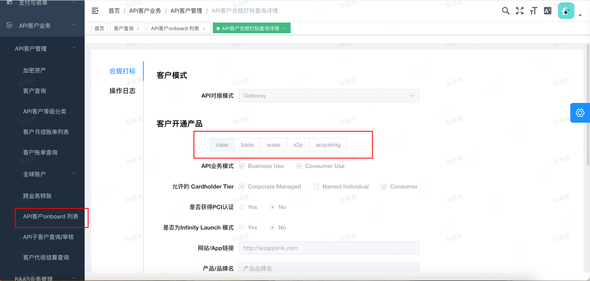
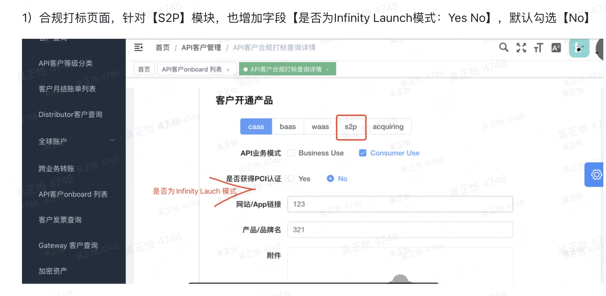
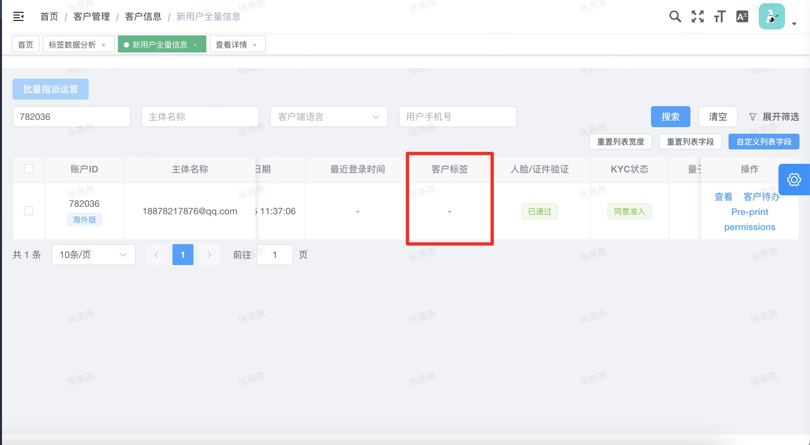
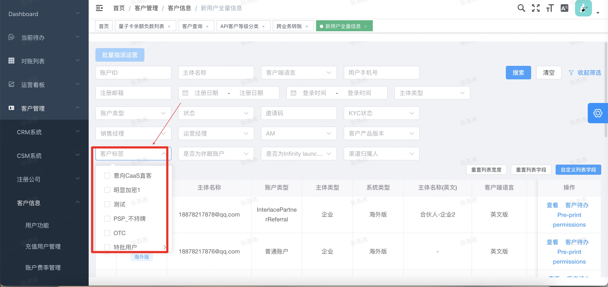

# 自动化打标

### **需求背景与目标**

原始需求：[标签管理](https://axss9gjoff.feishu.cn/wiki/ZgXrwrT3iibDBsk4i3UcET7pnMg?from=from_copylink)

- **背景**：当前客户标签库覆盖率低，主要依赖运营及业务人员人工手动打标，存在人力成本高、更新不及时、维护不标准化等问题。

- **目标**：依据于标签库建立**自动化打标规则**，实现客观基础标签、行业分类、产品使用状态及客户价值分层的自动判定与全生命周期更新，降低人工运维成本，提升标签数据。

### **标签自动化打标规则全量表**

#### **2\.1 基础产品与行业分类标签**

|**标签种类**|**一级标签**|**二级标签**|**三级标签**|**自动化规则**|
|---|---|---|---|---|
|客户类型|合作模式 |直客 |直客 |**触发条件**：根据系统是否新增打标为API客户 - 若 `未打标为API `$\rightarrow$ **直客** 每日0点轮询|
|||API客户 |Distributor / MOR / Gateway |**触发条件**：根据合规选定的API 对接模式 - 若 `对接模式 = Distributor` $\rightarrow$ **Distributor** - 若 `对接模式= MOR` $\rightarrow$ **MOR** - 若 `对接模式 = Gateway` $\rightarrow$ **Gateway** 每日0点轮询|
||合规分类|加密客户 \(crypto\) / 非加密客户 \(non\-crypto\)| |**触发条件**： - 若 `加密资产KYB状态 = 通过` $\rightarrow$ **crypto** - 若 `加密资产KYB状态 ≠ 通过` $\rightarrow$ **non\-crypto** 每日0点轮询|
||客户价值分层|**VIP客户** ||**触发条件****\(1 or 2\)**： 1. 卡消费量：近三个月（净消费）\>=100万\(API客户的消费量：母户\+子户总消费量\) 净消费 = 消费额 \- 撤销 \- 退款 每个月1号自动跑 2. 毛利贡献：当前QI/BB/BZ/三个汇总的渠道毛利 Top10客户 现在有现成的指标能够算出来毛利贡献@张皓然 涉及到代收和实收、应收，跟月结账单挂钩 每个月1号跑上个月的 3. ~~过去 30 天月均流水 \(GMV\) ~~$\ge X$~~ USD~~ ~~（指包含收款 Payin、付款 Payout、量子卡消费、兑换 FX 等所有交易成功的总金额）。~~ ~~注：需排除内部划转、转入、转出、调账入金、调账出金等交易类型~~ 4. ~~历史累计手续费净收益 ~~$\ge Y$~~ USD~~ ~~（统计客户总手续费的收益）~~|
|||**~~高潜客户~~** ||**~~触发条件~~**~~：~~ ~~系统每天自动跑数据，只要一个客户同时满足 ~~$\ge 3$**~~ 个正向信号~~**~~ 且 ~~**~~0 个负向信号~~**~~，就会自动打标【高潜客户】标签。~~ ~~参考下面2\.2部分的内容👇~~|
|||**~~普通客户~~**||**~~触发条件~~**~~：非 VIP 且非高潜的客户（系统默认兜底）~~|
|客户行业|跨境电商 |B2C零售 |平台卖家 |- **关联 KYB 业务与字段**：     - **全球账户 KYB** / **新增店铺** $\rightarrow$ `主营业务` \(Main business\)、`Platform` \(平台\) - **触发规则****\(1 \& 2 \& 3 \& 4\)**： 1. 全球账户KYB通过 2. 【全球账户 KYB】的 `主营业务` 选择 `电商`；**且** 3. 【全球账户 KYB】或【新增店铺】中的 `Platform` 字段选择：`Amazon`、`Lazada`、`ebay`、`Walmart`、`Shopee`、`Aliexpress`、`Tiktok shop`、`StockX`、`Goat`、`Mercari`、`App Store`、`其他`。 4. 店铺审核通过 每日0点轮询|
||||DTC|- **关联 KYB 业务与字段**：     - **全球账户 KYB** / **新增店铺** $\rightarrow$ `主营业务` \(Main business\)、`Platform` \(平台\)、`店铺链接` \(Store Link\) - **触发规则****\(1 \& 2 \& 3 \&4 \)**： 1. 全球账户KYB通过 2. 【全球账户 KYB】的 `主营业务` 选择 `电商`；**且** 3. 【全球账户 KYB】或【新增店铺】中的 `Platform` 选择 **独立站** 下的子项（`Shopify`、`Shoplazza`、`Shopline`、`Shopyy`、`自建站/self-built website`）；**或** `店铺链接` 域名后缀包含 `myshopify.com`、`Shoplazza` 等特征。 4. 店铺审核通过 每日0点轮询|
||||Hybird|- **关联 KYB 业务与字段**：     - **全球账户 KYB / 新增店铺 **$\rightarrow$** ****`Platform`**** \(平台\)** - **触发规则**：系统检测到同一客户同时存在已通过的 **电商平台** 店铺和 **独立站** 店铺/域名。 每日0点轮询|
|||B2B|采购商|- **关联 KYB 业务与字段**：     - **全球账户 KYB / 新增业务场景 **$\rightarrow$** ****`主营业务`**** \(Main business\)、****`全球账户主要用途`**** \(Main purpose of the global account\)** - **触发规则****\(1 \& 2 \&3\)**： 1. 全球账户KYB审核通过 2. `主营业务` 选择 `B2B业务`；**且** 3. `全球账户主要用途` 包含 `付款-至供货商或经销商` 每日0点轮询|
||||外贸工厂|- **关联 KYB 业务与字段**：     - **全球账户 KYB / 新增业务场景 **$\rightarrow$** ****`主营业务`**** \(Main business\)、****`行业类别`**** \(Industry category\)、****`全球账户主要用途`** - **触发规则****\(1 \& 2 \& 3 \&4\)**： 1. 全球账户KYB审核通过 2. `主营业务` 选择 `B2B业务`；**且** 3. `行业类别` 属于 **货物贸易 \(Tangible goods\)**（如 `服装和配饰`、`电子产品`、`金属及其制品`、`机器、机器器具、零件` 等）；**且** 4. `全球账户主要用途` 包含 `收款-资金来自海外客户` 每日0点轮询|
|||服务商|物流 |- **关联 KYB 业务与字段**：     - **全球账户 KYB / 新增业务场景 **$\rightarrow$** ****`主营业务`**** \(Main business\)、****`行业类别`**** \(Industry category\)** - **触发规则****\(1 \& 2 \& 3  \)**： 1. 全球账户KYB通过 2. `主营业务` 选择 `出海服务`；**且** 3. `行业类别` 中的 `服务贸易 (Intangible goods or service)` 选择 `物流运输 Freight, Shipping & Transportation` 或 `运输服务 Passenger railways...`。 每日0点轮询|
||||软件服务|- **关联 KYB 业务与字段**：     - **全球账户 KYB / 新增业务场景 **$\rightarrow$** ****`主营业务`**** \(Main business\)、****`行业类别`**** \(Industry category\)** - **触发规则****\(1 \& 2 \& 3 \)**： 1. 全球账户KYB通过 2. `主营业务` 选择 `出海服务`；**且** 3. `行业类别` 选择 `软件和技术服务 Websites, IT & Software`、`数据登记和管理服务 Data Entry & Admin` 或 `软件销售 Digital Goods`。 每日0点轮询|
||数娱\&服务|数字内容|Gaming|- **关联 KYB 业务与字段**：     - **全球账户 KYB / 收单 KYB **$\rightarrow$** ****`行业类别`**** \(Industry category\) / ****`商品类型`**** \(Product type\)** - **触发规则****\(1 or 2  \)**： 1. 全球账户KYB通过 or 收单KYB通过 2. 【全球账户 KYB】的 `行业类别` 选择 `网络游戏 Digital goods: online games`；**或** 3. 【收单 KYB】的 `商品类型` 选择 `游戏、虚拟物品 Game/Virtual Goods(Digital goods)`。 每日0点轮询|
||||直播 |- **关联业务**：     - KYC     - 全球账户 KYB     - 新增业务场景 - 关联字段：     - KYC\-\-\>主营业务     - KYB \-\-\>行业类别     - KYC\-\-\>业务描述 - **触发规则👉****\(1 \&2\&3\) or 4 **： 1. KYC通过 2. KYC【主营业务】= 其他 / 出海服务 3. KYC【业务描述】匹配： - Live Streaming  - 直播  - 主播  - 主播结算  - Streaming 4. 全球账户KYB通过且全球账户 KYB 行业类别： > `媒体和互联网视频服务`Media and Internet Video Service >  >  每日0点轮询|
||||创作者经济 |- **关联业务**：     - KYC     - 全球账户 KYB     - 新增业务场景 - 关联字段：     - KYC\-\-\>主营业务     - KYB \-\-\>行业类别     - KYC\-\-\>业务描述 - **触发规则👉****\(1 \&2\&3\) or 4 **： 1. KYC通过 2. KYC【主营业务】= 其他 / 出海服务 3. KYC【业务描述】匹配： - Creator - MCN  - Creator  - Creator Economy  - Content Creator  - OnlyFans  - Patreon  - Creator Platform  - 创作者平台  - 内容创作者  - MCN机构  4. 全球账户KYB通过且全球账户 KYB 行业类别： > `媒体和互联网视频服务 或 艺术设计，建筑和媒体服务` >  >  每日0点轮询|
|||技术\&软件 |软件出海|- **触发规则****（1 \& 2 \& 3）**： 1. KYC通过 2. KYC 主营业务 = 出海服务 3. KYC 行业类别 = 软件和技术服务 / 软件销售 每日0点轮询|
||||广告营销|- **关联 KYB 业务与字段**：     - KYC $\rightarrow$`行业类别`      - **全球账户 KYB** / **量子卡 KYB** $\rightarrow$`行业类别` \(Industry category\)、`量子卡消费目的` \(Main purpose\) - **触发规则👉****1   or 2 or 3 ****：** 1. KYC 主营业务 = 出海服务且 KYC行业类别 = 广告相关服务； 2. 全球账户KY B通过  且【全球账户 KYB】的 `行业类别` 选择 `广告相关服务 Advertising and Marketing Services`； 3. 量子账户KYB通过 且【量子卡 KYB】的 `量子卡消费目的` 勾选 `营销、广告 Marketing and advertising` 每日0点轮询|
||Fintech\&Web3|Web3/Crypto |交易所|- **关联 KYB 业务与字段**：     - **客户的KYC企业信息** $\rightarrow$** 主营业务、业务描述**     - 新增业务场景 $\rightarrow$** 业务描述** - **触发规则****（1 \& 2）**：  1. KYC 通过 且 KYC 主营业务 = Web3/数字货币相关;** ** 2. 在【KYC】或【新增业务场景】的 `业务描述`中，检索包含以下任一关键词（不区分大小写）： - `Exchange、CEX、DEX、交易所、撮合交易、Order Book、Trading Platform` 每日0点轮询|
||||Wallet Provider|- **关联 KYB 业务与字段**：     - **客户的KYC企业信息** $\rightarrow$** 主营业务、业务描述**     - 新增业务场景 $\rightarrow$** 业务描述** - **触发规则****（1 \& 2）**：  1. KYC 通过 且 KYC 主营业务 = Web3/数字货币相关;** ** 2. 在【KYC】或【新增业务场景】的 `业务描述`中，检索包含以下任一关键词（不区分大小写）： - `Wallet、MPC、AA Wallet、Custodial、Non-Custodial、Self-custody、Web3 Wallet、加密钱包、数字钱包、托管钱包。` 每日0点轮询|
||||Defi|- **关联 KYC 业务与字段**：     - **客户的KYC企业信息** $\rightarrow$** 主营业务、业务描述**     - 新增业务场景 $\rightarrow$** 业务描述** - **触发规则****（1 \& 2）**：  1. KYC通过 且 KYC 主营业务 = Web3/数字货币相关 2. 业务描述包含 DeFi / Staking / Yield / Protocol / 质押等。  每日0点轮询|
|||传统金融|PSP|- **关联 KYC 业务与字段**：     - KYC$\rightarrow$`主营业务`、业务描述     - 新增业务场景 $\rightarrow$业务描述 - **触发规则 ****（1 or 2）\& 3**： 1. KYC通过 且 KYC【主营业务】= 出海服务 / 其他 2. 海外版 KYC通过 且【主营业务】= 金融投资 3. 业务描述包含： - PSP  - Payment Service Provider  - 第三方支付  - 支付结算  - Payment Gateway  - 支付服务商  - 收单代理 每日0点轮询|
||||投资机构|- **关联 KYB 业务与字段**：     - 全球账户 KYB  / 量子账户$\rightarrow$`主营业务`     - 新增业务场景 $\rightarrow$`主营业务`     - 加密资产KYB $\rightarrow$`业务性质` - **触发规则****\(满足以下任一场景\)**： **场景 A**：【全球账户 KYB】或【量子卡 KYB】中，`主营业务` 选择 **`控股公司 (Holding Company)`**； **场景 B**：【新增业务场景】中，`主营业务 / 业务性质` 选择 **`金融投资`**； **场景 C（关键词匹配）**：在  `业务描述 `中包含以下任一关键词： `VC`、`PE`、`Venture Capital`、`Private Equity`、`Family Office`、`家族办公室`、`Web3 基金`、`Web3 Fund`、`风险投资`、`私募股权`。 每日0点轮询|
||||银行|- **触发规则 ****（1 \& 2）**： 1. KYC通过 且 KYC 主营业务 = 金融投资/  出海服务 / 其他 2. 业务描述包含： - Bank  - Commercial Bank  - Digital Bank  - Neo Bank  - 商业银行  - 数字银行  - Trust Company  - 持牌信托 每日0点轮询|
||平台型企业|平台|众筹平台|- **关联 KYB 业务与字段**：     - **全球账户 KYB** $\rightarrow$ 主营业务 \(`Main business`\)、`业务描述`     - **新增店铺** - **触发规则****\(1 or 2\)**： 1. **【全球账户 KYB】**：`主营业务` 选择 **`电商 (E-commerce)`**，且在其二级 `Platform (平台)` 中选择了 **`众筹平台`** 下的枚举项（`Kickstarter`、`Indiegogo`）；**或** 2. 【新增店铺】的 `平台 (Platform)` 选择 **`众筹平台`** 下的枚举项（`Kickstarter`、`Indiegogo`）。|
||||自由职业者平台|- **触发规则****\(1 \& 2\)**： 1. KYC通过 且 KYC 主营业务 = 出海服务 / 其他 2. 业务描述包含： - Upwork  - Fiverr  - Freelance  - Outsourcing Platform  - Freelancer  - 零工撮合  - 兼职分发  - 自由职业者平台 每日0点轮询|
||||分销平台|- **关联 KYB 业务与字段**：     - **全球账户 KYB**  $\rightarrow$**业务描述**     - 新增业务场景 $\rightarrow$**业务描述**     - 交易$\rightarrow$**备注** - **触发规则****\(1 or 2\)**： 1\. **静态 KYB 条件**：在【全球账户 KYB】或【新增业务场景】的 `业务描述` 中包含分销特征关键词（如 `分销`、`代理商分账`、`Distributor Network`、`佣金结算`、`多级分销`）； 2\. **动态交易条件**：系统检测到客户调用**批量出款 API** 或 **分账 API** 频次高于设定阈值（如月均大于等于 $N$ 笔），且交易附言/备注包含 `分销`、`佣金`、`Commission`、`Affiliate`。 每日0点轮询|
|产品类型|账户服务 |银行账户|Bank Portal|- **关联 KYB 业务与字段**：     - **全球账户 KYB** $\rightarrow$ KYB 审核状态      - **API客户基础信息打标** $\rightarrow$ `是否新增打标为API客户` - **触发规则**：     - `全球账户KYB 状态 == 通过` **AND** `是否新增打标为 API 客户 == 否`（即直客模式）|
||||Baas|- **关联查询**：     - **系统Admin** $\rightarrow$ `开通产品打标`、`新增打标为API客户` - **触发规则**：     - `Admin 开通产品打标 == BaaS` **AND** `新增打标为 API 客户 == 是`。 |
|||发卡服务|Card Portal|- **关联 KYB 业务与字段**：     - **量子卡 KYB** $\rightarrow$ KYB 审核状态      - **API客户基础信息打标** $\rightarrow$ `是否新增打标为API客户` - **触发规则**：     - `量子卡 KYB 状态 == 通过` **AND** `是否新增打标为 API 客户 == 否`（即直客模式）|
||||Caas|- **关联查询**：     - **系统Admin** $\rightarrow$ `开通产品打标`、`新增打标为API客户` - **触发规则**：     - `Admin 开通产品打标 == CaaS` **AND** `新增打标为 API 客户 == 是`。 |
||||White Label|\-\-|
|||数字货币钱包|Scan to pay| 系统API客户onboarding审核中检测客户`KYB打标为S2P` |
||财富管理|资金兑换|法币FX|触发规则 **\(1 \& 2\)**： 1\. **币种类型**：交易涉及 **法币与 法币之间的双向兑换（如 USD/EUR/HKD/SGD 等，排查加密货币与稳定币）；**； 2\. **动作校验**：客户产生累计成功出入金兑换交易笔数 $\ge 1$ 笔（`交易状态 == Success`）。|
||||On/Off Ramp|触发规则 **\(1 \& 2\)**： 1\. **币种类型**：交易涉及 **法币（包含加密 USD 钱包等法币余额账户）与 Stablecoin（如 USDT/USDC）之间的双向兑换**； 2\. **动作校验**：客户产生累计成功出入金兑换交易笔数 $\ge 1$ 笔（`交易状态 == Success`）。|
|||理财增值|treasury|- **关联 KYB 业务与字段**：     - **粒子理财 KYB** $\rightarrow$ KYB 审核状态  - **触发规则**：     - `粒子理财 KYB 状态 == 通过` 问一下涛哥怎么判定|
||收单服务|商户收单|数币收单|- **对应 KYB 业务与真实字段**： - **KYB 业务线**：`收单 KYB` - **触发条件**： 1. `收单 KYB 状态 == 通过` **AND** 2. 待定|
||综合解决方案|行业集成|Infinity Launch |系统API客户onboarding审核中检测客户`是否为Infinity Launch = 是` |

#### ~~2\.2 高潜标签打标规则\-\-不做~~

|**信号编号**|**signal**|**触发规则**|**数据源**|**说明**|
|---|---|---|---|---|
|P1|**Volume growth** \(交易量增长\)|30 天滚动交易量连续 2 个月以上环比增长 $\ge 20\%$，且上月交易量  ≥ $\[X\]|交易量 = 卡净消费 \+ 加密承兑 \+ 全球账户外部入金|客户跑的交易流水越来越大。|
|P2| **Card portfolio expanding** \(发卡规模扩大\)|净新增活跃卡数量环比增长 $\ge 10\%$，且上月活跃卡量 $\ge [X]$。 |量子卡交易 |客户开卡、用卡需求增加。|
|P3|**API adoption deepening** \(API 接入加深\)|充值频率相比前 30 天保持或上升；平均单笔充值金额增加；且上月总充值量 $\ge [X]$。|API客户（MOR、Gateway、Distributor）|客户接入了我们更多的新功能/新业务。|
|P4|**Top\-up frequency stable/rising** \(充值频率稳定或上升\)|充值频率相比前 30 天保持或上升；平均单笔充值金额增加；且上月总充值量 $\ge [X]$。 |充值 = 全球账户外部入金\+加密钱包链上入金\+量子账户外部充值||
|P5|Bills paid on time \(按时结清账单\)|最近 3 个月的账单均在账期内按时支付。|月结账单|履约良好，没有逾期欠款。|
|P6|Exceeding minimum commitment \(超过最低保底承诺\)|交易量连续 2 个月以上达到合同约定最低保底承诺的 ≥ 150%   |拿客户的最低交易承诺量与实际交易量做对比|表现远超签约时的预期，超额完成 KPI。|

### **触发机制设计**

系统需提供 **3 种自动化运行机制** 以确保数据的时效性与准确性：

1. **初始化脚本（批量执行）**：

    系统上线时，对历史存量客户执行一次全量自动化规则计算。

    处理流程：

    > 存量客户 → 获取当前有效数据 → 执行全部自动化规则 → 写入自动化标签
    > 
    > 

2. **~~事件驱动打标\-\-不做~~**~~：~~

    - **~~KYB 状态变更事件（实时触发）~~**~~：客户行业、产品类型。~~

    - **~~API客户新增/KYB打标（实时触发）~~**~~：客户类型（直客/API）、Bank Portal/Baas/Caas/White Label 等产品标签。~~

    - **~~首笔交易成功事件~~**~~ 实时触发：法币FX、On/Off Ramp 等交易类标签激活。~~

3. **定时任务打标（每日/月度跑批）**：

    - **每月 1 日跑批**：计算过去 30 天卡的净消费量与渠道毛利，更新 VIP客户标签。

    - 每日0点轮询：每日0点查询KYB状态变更、KYB打标、首笔成功交易等

### 标签规则冲突处理

以下标签采用互斥逻辑：

- **合作模式：**直客 / API客户（Distributor / MOR / Gateway）；

- **合规分类：**crypto / non\-crypto；

- **客户价值分层：**VIP / 高潜 / 普通

1. 同一客户同一维度只能保留一个最终结果；

2. 满足规则时自动增加标签；

3. 不再满足规则时自动撤销标签；

### Admin优化

- 新增字段：规则类型 （系统预置/自定义规则），用来标识规则来源类型

- 规则描述：对于系统预置的自动化规则，规则描述就展示自动化规则的判定条件逻辑。

- 【系统预置】类型的规则，对应操作：启用、停用、不可删除和编辑

- 新增搜索条件：规则类型（下拉框）、所属标签（文本框模糊搜索）、全部分类标签（下拉框）

待修复的问题：

1. 新用户全量信息列表，客户标签字段展示问题，目前打完标之后展示为空

2. 新用户全量信息菜单，客户标签搜索条件，目前搜索条件不是全量标签，而是仅展示了合规标签

