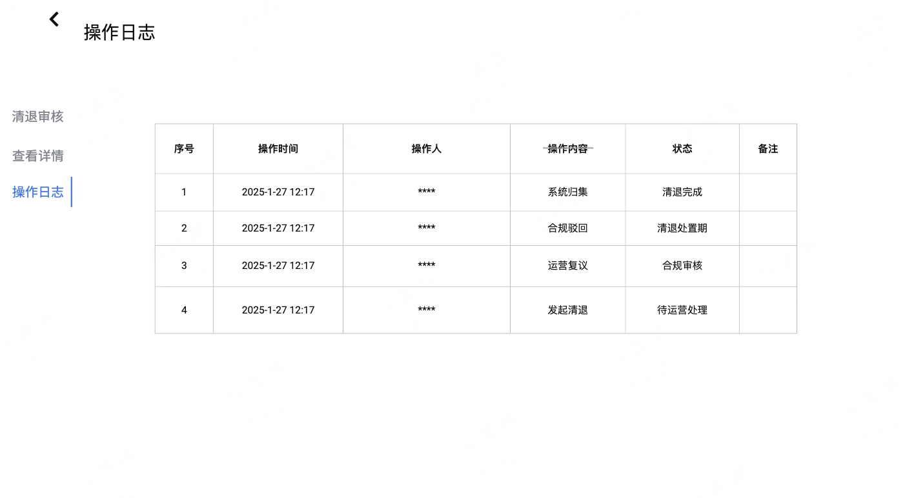
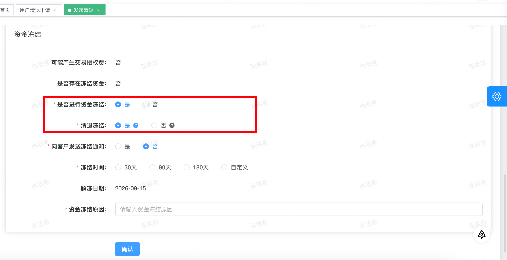

# 清退优化

# 迭代规划

|**迭代周期**|**时间**|**迭代内容**|
|---|---|---|
|第一期||* [ ] 优化清退流程：清退审核通过后，不再由财务统一退款<br>* [ ] 由合规配置清退操作期（30/90 天或自定义）<br>* [ ] 在操作期内，客户通过客户端自行完成允许的资金操作<br>* [ ] 覆盖全球账户、量子账户、加密账户、~~粒子理财~~三类业务<br>* [ ] 操作期结束后，系统自动进入后续归集或人工处理流程<br>因为粒子理财3\.0上线，需求不兼容挪到二期优化|
|第二期|9\.11\-\-9\.24|支持粒子理财3\.0业务清退<br>清算手续费优化，支持扣成负数<br>加密暂停入金的admin功能处理<br><br>|

# **需求背景**

当前 admin 系统已支持由合规发起的【单业务清退 / 全量清退】流程，并在清退审核完成后，由运营/财务通过“清退退款处理”模块执行线下打款退款。但随着业务复杂度提升（尤其是加密账户、量子账户、多钱包并存的情况），现有模式存在以下问题：

- 财务人工退款成本高、易出错

- 清退资金来源复杂，难以准确核对客户最终可退余额

- 客户无法自主处理资金，体验差

- 现有清退流程未覆盖加密账户场景

# 需求目标

* [ ] 优化清退流程：清退审核通过后，不再由财务统一退款

* [ ] 由合规配置清退操作期（30/90 天或自定义）

* [ ] 在操作期内，客户通过客户端自行完成允许的资金操作

* [ ] 覆盖全球账户、量子账户、加密账户、粒子理财四类业务

* [ ] 操作期结束后，系统自动进入后续归集或人工处理流程

# 适用范围

- 客户类型：直客 / 白标客户（仅发起通知给这个白标本标客户）

- 清退类型：

    - 单业务清退（新增加密资产、粒子理财业务）

    - 全量清退（包含加密资产、粒子理财业务）

# 整体流程概述

1. 合规在 Admin 发起清退申请（单业务 / 全量）

    - 新增功能：合规需配置【清退处置期】（30 天 / 90 天 / 自定义）

2. 清退申请走既有审核流程（可申诉的情况下，可由运营发起申诉审核 ；如果不允许申诉，默认清退审核直接通过，就直接进入清算对账，清算完成之后进入清退处置期）

3. 清退发起通过后：

    - 客户状态由“冻结”进入“清退处置期（有限可操作）”

    - 量子卡资金的变动：如果达到倒计时账户为负数，发邮件通知（告知客户要还款，给客户一个账户怎么还？？？），T\+\*日财务发起流程后，娟娟做平账，财务要转钱给到资金做坏账处理。如果客户有其他有余额的账户，是否要支持其他账户自动扣钱？

    - 有退款怎么办？

4. 客户在处置期内，通过客户端自行处理资金

5. 操作期结束（系统自动）：

    - 若倒计时归零，系统自动将账户状态切换为“清退完成”，客户端禁止登录（全量清退的情况下）。

    - 若客户资产全部清零，则无需处理。账户状态为“清退完成”。

    - 若客户资产未全部清零，系统进入超期归集，清退状态仍然是“清退完成”。

    

# **状态转换逻辑**

|**清退状态**|**操作**|页面表现|**说明**|
|---|---|---|---|
|对账中|查看|- Admin端：此时只能查看，等待系统做清算对账处理|合规发起清退申请之后，系统进入对账流程|
|对账失败|重试   查看|- 客户端：对应相关清退的功能受限，客户此时未能解冻<br>- Admin端：等待技术手动操作账单，完成之后合规手动重试，完成对账|等待技术手动处理，完成之后通知合规手动重试|
|清退处置期|查看<br>|- 客户端：所有页面强制显示清退倒计时Banner，相关功能仍然受限，但允许：<br>    - 内部互转<br>    - 链上提币<br>    - 提现至同名银行账户<br>- Admin端：用户清退申请查看详情页面展示用户清退操作列表|账单平账之后，判断以下两种情况进入“清退处置期”：<br>1. 不允许运营申诉<br>2. 运营直接提交，不发起复议|
|运营审核中|运营审核、查看|- 客户端：对应相关清退的功能受限，客户此时未能解冻<br>- Admin端：此时账单已平，且判断运营可以发起审核，此时等待运营做审核|如果允许申诉，则操作支持运营审核|
|合规审核|合规审核、查看|- 客户端：对应相关清退的功能受限，客户此时未能解冻<br>- Admin端：此时等待合规做复核|运营发起申诉复议之后，等待合规审核|
|取消清退|查看|- 客户端：所有功能恢复正常<br>- Admin端：清退状态变更|运营申诉复议，合规审核通过，取消清退<br>|
|清退中|重试  查看|- 客户端：对应相关清退的功能受限，客户此时未能解冻<br>- Admin端：等待冻结资金完成线下退款之后，客资手动重试，完成清退流程|清退处置期结束之后，判断客户是否还存在冻结资金，如果还存在冻结资金，则由客资完成线下退款之后手动重试，由“清退中”的状态流转至“清退完成”|
|清退完成|查看|- 客户端：<br>    - 对应相关清退功能仍然受限，相当于冻结，对应清退业务的功能菜单全部隐藏。<br>    - 如果是全量清退，则客户端禁止登录。<br>- Admin端：<br>    - 用户清退申请，查看详情页面展示用户清退操作列表<br>    - 增加一个功能页面：超期账户管理|1. 清退处置期结束之后，直接状态变更为“清退完成”<br>2. 客户只注册，但并未申请KYC/KYB or 未审核通过，则账单已平之后状态立即变更为“清退完成”<br>3. 客户注册，完成了KYC/KYB，但是账户余额为0，则账单已平之后状态立即变更为“清退完成”<br>|

#### 关于对账流程的说明：

发起清退  👉 对账中（如果存在Pending交易，持续停留在对账中），若无Pending交易订单 👉 自动对账  👉 如果账平，直接进入运营审核 or 清退处置期 ； 如果账单不平，则状态为“账单不平”，等待人工排查原因，手动处理之后再手动重试进入下一个流程

# Admin 端需求

### 原型图：

https://modao\.cc/proto/rb1ACXMWsl2gqhoKmofY6f/sharing?view\_mode=device\&screen=rbpV9OXQPiVirUgpx\&canvasId=rcURKpYrV9Om3SWBttMhBU 

### 后台菜单路径：

- **清退管理**

    - 用户清退申请

    - 超期账户处理

本需求主要覆盖【用户清退申请】模块。

## 6\.1 发起清退

#### **路径：**Admin → 清退管理 → 用户清退申请 → 发起清退


#### （1） 页面功能

用于展示平台所有清退申请记录，支持条件筛选、状态查看及进入详情页处理。

#### （2） 查询条件

支持以下查询条件组合使用：

- 客户名称（模糊搜索）

- 客户 ID

- 清退类型（下拉框：清退、注销）

- 清退业务（下拉框：全球账户、量子账户、加密资产、粒子理财）

- 清退状态（下拉框）

#### （3）操作按钮

- **搜索**：按筛选条件查询清退记录

- **发起清退**：进入清退发起弹窗

#### （4）列表字段说明

|字段名称|说明|
|---|---|
|客户名称||
|客户邮箱||
|客户ID||
|清退类型|~~全量清退 / 全球账户清退 / 量子账户清退 /~~~~ 加密资产清退 / 粒子理财清退 / 注销~~。   清退 / 注销|
|清退业务|全球账户清退 / 量子账户清退 / 加密资产清退 / 粒子理财清退 |
|清退状态|对账中/ 对账失败 / 运营审核中 / 合规审核 / 清退处置期 / 清退中 / 清退完成 / 取消清退<br>|
|清退发起时间|清退申请提交时间|
|清退处置开始时间|审核通过并进入清退处理的时间|
|清退处置结束时间|清退倒计时结束|
|操作|审核 / 查看详情|

> 不同清退状态下展示的操作按钮不同：
> 
> - 参考 5\. 状态转换逻辑
> 
> 

## 6\.2 发起清退弹窗


本次发起弹窗优化：新增了清退类型选择、清退业务选择、清退处置期配置（默认30天），其余字段和相关逻辑都保持不变。

发起清退时，允许冻结的资金类型：仍然只允许全球账户、闪付钱包、量子账户的资金冻结，加密账户的资金当前不允许冻结，等二期优化。

#### （1）清退类型选择：清退 / 注销

#### （2）清退业务选择

支持以下清退业务（多选）：

- ~~全量清退~~

- 全球账户清退

- 量子账户清退

- 加密资产清退

- 粒子理财清退

- 注销

> 不同清退类型仅影响对应业务模块，不影响其他未清退业务。
> 
> 

#### （3） 清退处置期配置

- 30 天

- 90 天

- 自定义（支持选择具体截止日期）

> 说明：
> 
> - ~~清退处置期用于~~**~~非自动清算型资产~~**~~的客户自行资金处置~~
> 
> - 粒子理财清退不适用处置期，选择清退类型是粒子理财，则不展示清退处置期说明： 
> 
> 

#### 说明：

> 1. 清退审核通过后，不再生成“待上传凭证”的清退退款记录，而是清退状态变更为“清退处置期”。
> 
> 2. 系统根据客户清退操作期配置，自动控制客户侧可操作时间。
> 
> 3. 如果单业务清退类型是：粒子理财，则不展示清退处置期配置，等清算完成之后立即做归集动作，不让客户操作。
> 
> 4. 特殊情况：清退全球账户，VA账户遇到渠道有问题的话（目前判断客户是否开通了RD账户），合规发起清退就会报错（报错内容：当前客户开通了RD渠道账户，暂不支持清退），然后由人工介入处理。
> 
> 5. 清退流程中如果还含有冻结资金和解冻资金怎么处理？
> 
> - 清退发起前有冻结资金、发起中选择冻结资金：判断是否还含有冻结资金，如果解冻时间大于等于清退处置期时间，则页面报错，不允许发起清退
> 
> - 清退发起后发起冻结资金：允许发起冻结资金，但是在解冻之前，清退状态一直是“清退中”，等待解冻资金完成外部退款之后，清退状态变更为“清退完成”，不做监听，**在“清退中”这个状态的列表中增加一个“重试”的操作，点击重试**，系统将“清退中”的状态变更为“清退完成”
> 
> 
> 
> 
> 
> - ~~“清退中” ~~清退发起之后客户端处理：此时客户对应的清退业务功能冻结，比如客户全球账户单业务清退，则全球账户相关的操作都不允许发起（不允许新增全球账户账户、不允许全球账户付款、禁止全球账户的资金划转、不允许发起闪付、不允许发起结汇），一旦发起点击“确定”按钮，则页面报错：“您的全球账户当前正处于清退处理阶段。在清退完成前，相关功能将暂时无法使用。如有疑问请联系您的客户经理或客服。”
> 
> - EN: Your Business Account is under offboarding\. Related features are temporarily unavailable\. If you have any questions, please contact your account manager or customer support\.
> 
> 
> 
> 6. 问题点：
> 
>     - 清退业务本身是否支持内部划转入？？（单业务清退：不限制）
> 
>     - Qbit：量子账户从Interlace USD打进的禁止转出到任何业务，只能消费，这个合规限制是否延续？（不延续，支持内部划转出去）
> 
> 

发起清退的邮件模版\-\-先看一下现有的模版做优化

## 6\.3 清退审核页


#### （1）页面说明

用于运营 / 合规人员对清退申请进行审核决策，并查看客户当前清退账户信息与资产冻结情况。

#### （2）客户基础信息

展示字段包括：

- 客户名称

- 法人姓名

- 注册手机号

- 注册邮箱地址

- 清退类型

- 清退原因

- 原因描述

- 清退发起时间

#### （3）业务余额清算信息

按业务类型展示当前余额（只读）：

- 量子账户余额

- 加密资产余额

    - USD 钱包

    - USDC / USDT

    - BTC / ETH

- 全球账户余额

    - 闪付钱包

    - 美元账户

    - 港元账户

    - 英镑账户等

#### （4）资金冻结信息

- 是否清退冻结：是 / 否

- ~~冻结资金退还时间~~

- 冻结资金金额

- 解冻时间

说明：资金冻结信息数据展示从“用户资金冻结管理”模块中取值。

#### （5）审核意见

- 审核意见（下拉选择）：

    - 审核通过

    - 审核驳回

- 备注（选填）

#### （6） 审核结果处理逻辑

- 运营审核通过：

    - 则默认不申诉，直接清退审核通过进入【清退处置期】

    - 系统进入清退处置期执行流程

- 运营审核驳回：

    - 视为申请复议，则需要上传附件，流程流转至合规侧审核

    - 状态进入【合规审核】

- 合规审核通过：

    - 则判断运营申诉合理，取消清退，客户所属业务恢复正常

    - 状态进入【取消清退】

- 合规审核驳回：

    - 默认运营申诉不合理，直接清退审核通过进入清退处置期

    - 系统进入清退处置期执行流程

#### ~~粒子理财清退特殊说明⚠️：~~

- ~~粒子理财在~~**~~清退发起后即不可操作~~**

- ~~不支持申购 / 赎回~~

- ~~审核通过后系统直接进入清算~~

- ~~清算完成后：~~

    - ~~系统自动赎回~~

    - ~~资金划转至闪付钱包或 USD 钱包~~

- ~~不存在客户清退处置期~~

## 6\.4 操作日志



系统需记录以下关键操作日志：

- 清退发起记录（包含操作时间、操作人）

- 审核操作记录（包含~~操作内容~~、状态）

- 如果上传附件，则一同展示

## 6\.5  查看详情


查看详情优化：新增了客户清退操作记录列表，其余字段和相关逻辑都保持不变

> 查看详情增加客户操作记录列表，列表包含以下字段：
> 
> - 操作人：客户名称 / 客户ID
> 
> - 操作类型（提币 /  内部划转（全球账户/量子账户/加密账户）等聚合操作记录需求上线 / 付款提现）
> 
> - 操作内容
> 
> - 操作金额
> 
> - 操作时间
> 
> 

说明：详情页的“客户基础信息”栏中增加“清退处置开始时间”、“清退处置结束时间”，如果无数据，则对应展示空数据“\-\-”


# 客户端需求

## 7\.1 客户整体状态控制

### 7\.1\.1 清退发起之后（待申诉）

当合规发起清退，则客户进入清退冻结模式，之前的全球账户、量子账户单业务清退在此时这个流程中，用户端不用做改动，重点说明加密资产、粒子理财单业务清退的处理和全量清退的处理

- 客户端整体进入【清退模式】

- 禁用所有正常业务功能（充值、付款、新增收款人、新增全球账户等）

- 仅保留清退允许的功能入口

### （1）加密资产清退：

禁用所有加密资产业务功能（充值、转出、交易、新建钱包、余额归集、新增收款方、从量子账户转出到加密资产、加密资产USD钱包发起付款），当点击确认按钮（校验逻辑跟现在的清退保持一致，属于**后置校验**。用户在触发“充值”或“转出”等交易动作时，前端不进行判断，允许用户完成全部交互。系统仅在点击最终【确认】按钮请求接口时，才返回校验失败报错。）

页面提示如下： 

> 您的加密账户当前正处于清算处理阶段。在清算完成前，相关功能将暂时无法使用。 清算结束后，账户将进入清退处置阶段，您可进行后续资金处理。如有疑问请联系您的客户经理或客服。
> 
> 

EN:

> Your CryptoConnect account is under offboarding\. Related features are temporarily unavailable\. If you have any questions, please contact your account manager or customer support\.
> 
> 


### （2）粒子理财清退：

禁用所有粒子理财业务功能（申购、赎回），当点击确认按钮，页面提示：

> 由于您的粒子理财账户已进入清退流程，粒子理财业务已暂停使用，暂不支持申购或赎回操作。
> 
> 粒子理财资产将由系统统一进行清算处理，清算完成后资金将自动划转至您的闪付钱包或 USD 钱包。如有疑问，请联系您的客户经理或客服。
> 
> 

EN:

> Your Yield Treasury account is under offboarding\. Related features are temporarily unavailable\. If you have any questions, please contact your account manager or customer support\.
> 
> 


### （3）全量清退：

禁用所有全球账户、量子卡、加密资、粒子理财产业务功能（充值、转出、交易、新建钱包、余额归集、申购、赎回、新增收款方），当点击确认按钮，页面提示： 

> 您的账户当前正处于清算处理阶段。在清算完成前，相关功能将暂时无法使用。 清算结束后，账户将进入清退处置阶段，您可进行后续资金处理。如有疑问请联系您的客户经理或客服。
> 
> 

EN:

> Your account is under offboarding\. Related features are temporarily unavailable\. If you have any questions, please contact your account manager or customer support\.
> 
> 

说明：通知的逻辑跟以前保持一致。


### 7\.1\.2 客户清退处置期间

### （1）首页顶部固定展示清退 Banner

- 单业务清退 or 全量清退，首页顶部固定展示清退 Banner

- 展示内容包括：

    - 当前处于清退操作期

    - 操作截止时间

    - 倒计时（剩余 X 天 X 小时 X 分） 

    设计图如下：

    


> ~~⚠️ 账户正在清退中~~
> 
> ~~请在截止时间内完成资金处理，逾期将无法操作。~~
> 
> ~~剩余时间：\*\*\*\* 天 \*\*\*\* 小时 \*\*\*\* 分~~
> 
> ~~您的全球账户、量子账户、加密资产账户已进入清退操作期。请尽快通过允许的方式处理所有资金，包括：内部划转、同名付款、加密资产转出链上提币。~~
> 
> ⚠️账户清退处理中，剩余时间：3 天 12 小时 45 分
> 
> 为避免影响您的资产，请在截止时间前完成资金处理，逾期将无法操作。
> 
> 本次清退账户：全球账户、量子账户、加密资产账户
> 
> 您可通过以下方式处理资金：内部划转、同名付款、加密资产转出链上提币
> 
> 

说明：

1. 根据不同的清退业务展示“您的全球账户、量子账户、加密资产账户已进入清退操作期。”

2. 资金处理方式展示规则：

- 如果清退业务包含“加密资产”：则展示“请尽快通过允许的方式处理所有资金，包括：内部划转、同名付款、加密资产转出链上提币。”

- 如果清退业务不包含“加密资产”：则展示“请尽快通过允许的方式处理所有资金，包括：内部划转、同名付款。”

EN:

> **~~Account Offboarding in Progress~~**
> 
> 
> 
> ~~Your Business Account, Infinity Account, and Crypto Connect account are under offboarding\. Please transfer or withdraw your funds via internal transfer, withdrawal, or on\-chain transfer before the deadline\. After the deadline, no further actions will be available\.~~
> 
> 
> 
> **~~Time remaining: ~~**~~xxx days xxx hours xxx minutes~~
> 
> ⚠️ Account Offboarding Underway，Time Remaining: 3 days 12 hours 45 mins
> 
> To protect your assets, please complete fund processing before the deadline\. No further operations will be allowed after expiration\.
> 
> Accounts being offboarded: Business Account, Infinity Account, Crypto Connect Account
> 
> Available fund processing methods: Internal Transfer, Same\-Beneficiary Payment, On\-Chain Crypto Withdrawal
> 
> 

### （2）触发客户邮件和站内信通知


### （3）清算手续费金额：35 USD / 笔

这个手续费就是清算结束之后立即产生一条35USD的手续费订单。

1. 全球账户、量子账户单业务清退、全量清退：35 USD的手续费订单放在~~闪付钱包 ~~对应扣款账户的交易明细（全量清退扣手续费优先级：闪付钱包 \> 全球账户（美元账户） \> 加密USD 钱包 \> USDC钱包 \> USDT 钱包  ）

2. 加密资产单业务清退：手续费订单放在主钱包交易明细中。

    - 判断哪个主钱包大于35，直接扣掉35（优先USD钱包 \> USDC钱包 \> USDT 钱包 \>~~ BTC \> ETH~~ ）

    - 如果以上三个钱包都没有钱，拿闪付钱包扣款

    - ~~如果不足的话，则pending，等客户操作提币的时候，自动加35的手续费（手续费独立于gas fee）~~  **这块等二期优化**

3. 清算手续费：加一个code用来标记映射

4. ~~如果清算金额不足35 USD，则也会产生一笔35USD的手续费订单，扣成负数。等待后续财务走流程去做坏账处理。 ~~  **这块等二期优化**

记录：客户清退处置期操作加一个校验：必须余额是大于0的，不然就不允许做出金操作。

## 7\.2 清退处置期间允许的客户操作

### 7\.2\.1 内部划转

- 支持互转账户：

    - 全球账户 ↔ 量子账户 ↔ 加密账户 都支持互转

### 7\.2\.2 法币提现

- 外部提现规则：

    - 支持外部付款

    - 仅允许提现至【同名银行账户，同名定义：公司或者法人/UBO】

- ~~不允许新增/编辑收款人（仅允许新增同名账户）~~

- 历史收款人默认失效，如果收款方选择错误，发起提现，则页面报错：

> 当前您处于账户清退期间，仅允许提现至本人银行账户。
> 
> 

EN:

> During offboarding, withdrawals are only allowed to your own bank account\.
> 
> 

**说明：**

1. 量子账户单业务清退：出金不受同名影响，全球账户付款与加密代付都正常使用，量子账户只能与全球账户、加密账户互转

2. 如果清退业务只要包含全球账户：则允许提现至同名银行账户，且历史收款人默认失效。等全球账户单业务清退完成之后，付款这块（包含创建/编辑收款人）恢复正常。


**说明：所有清退操作出金订单（全球账户\-\-出金订单、加密资产\-\-转出管理等发起交易的地方），加上系统备注提醒：清退客户（红色字体展示），提升合规在审核时的判断。如下图👇：**


### 7\.2\.3 加密资产提币 / 承兑

- 支持客户链上提币

- 支持子钱包归集到主钱包

- 支持内部划转

- 限制：提币只能从主钱包提币（待确认）


### ~~7\.2\.4 粒子理财赎回~~

- ~~支持粒子理财账户转出到全球账户、USD钱包、闪付钱包~~


## 7\.3 操作期结束处理

### 7\.3\.1 客户端

- 客户不支持登录（全量清退）

- 对应各个清退的功能模块隐藏（单业务清退）

- ~~若支持登陆，则所有操作入口都关闭，客户发起所有操作行为（是否支持下载账单、账户信息？），页面都报错：~~

> ~~清退操作期已结束，账户已冻结，请联系客服或您的客户经理处理。~~
> 
> 

### 7\.3\.2 Admin

### （1）触发条件：

当系统时间 \>【清退处置结束时间】，所有清退账户状态可标记为“清退完成”：

- 若客户资产未全部清零，，且满足以下任一条件：

    - 全球账户余额 \> 0

    - 量子账户余额 \> 0

    - 加密账户余额 \> 0

    - 粒子理财账户余额 \> 0

### （2）处理方式：

系统自动执行：

1. 客户端：

    - 禁止相关业务资金类操作（指单业务清退）

    - 不允许登录（指全量清退）

2. Admin 端：

    - 自动生成一条【超期账户处理记录】

    - 记录超期触发时间

    - 超期默认自动放弃（来闹的话，全部都线下，线下走完之后线上通过“查看详情”页面手动增加给备注和附件入口。）

    设计图如下：


### （3）归集处理规则：

- 则剩余资金统一归集：

- 归集时点：

    - 清退处置期结束

- 归集方式：

    - 全球账户统一转入闪付钱包

    - 量子账户统一转入闪付钱包

    - ~~粒子理财账户统一优先转入USD钱包（若有） \> 闪付钱包~~

    - 加密账户统一转入主钱包（所有子钱包统一归集到同币种的主钱包）

- 归集完之后所有信息流归 0（对应闪付钱包、USD钱包产生一条扣除对应归集金额的出金订单）

- 真实资金流由资金线下处理

如果量子账户没有钱，但是闪付钱包有钱，超期处理逻辑：

判断清退是否是全量清退还是单业务量子卡清退，如果是全量清退，那么就闪付钱包【超期扣除】；如果是单业务清退，那么就不做超期处理

关于信息流归 0 的特殊说明：

1. 全量清退说明：指选择当前清退四个业务，且判断该客户无其他可用业务（不包含收单\+S2P），则此视为全量清退。

2. 加密资产单业务清退：如果是加密资产单业务清退，那么在归集之后对账账户需要信息流抹成0。

3. 全量清退：如果客户是全量清退，此时在归集之后闪付钱包 or USD钱包全部都需要信息流抹成 0。


# 入金规则约束

- 清退从发起期间开始，所有入金不得进入正常可用余额：

    - 全球账户入金：

        - 全球账户入金审核：统一设置“已拒绝”

        - 所有入金订单自动进入全球账户入金退款流程

    - 加密资产入金：

        - 判断入金金额是否小于gas fee，如果小于则状态变成“已拒绝”

        - 如果大于，则加密资产充值管理：统一设置“暂停入金”，则入金订单进入链上充提管理人工退款流程；如果过了清退操作期，还是“暂停入金”的话，客户端不做优化，admin\-\-充提\-\-操作增加：人工处理退款，退款完成之后，这个状态变成“已退款”。

    - 量子账户入金：

        - 资金创建量子账户入金之后，系统自动拒绝

        - 拒绝之后走量子卡入金退款流程

- 清退期间所有对外资金流：

    - 外部付款仅限同名账户

    - 加密资产仅限线上提币

# 关于邮件与站内信通知

## 9\.1 邮件/ 站内信 通知节点

**说明：资金冻结的功能逻辑与通知逻辑都保持不变。**

## 9\.2 通知内容

|**流程节点**|**触发场景**|**标题**|**展示内容**|**展示内容（英文版）**|
|---|---|---|---|---|
|发起清退（不被允许申诉）<br><br>|合规发起清退<br>|【Qbit】您的账户将被关户处理<br>|尊敬的\<用户姓名\>：<br>感谢您使用我们的服务。根据合规及风险管理要求，您的账户已被纳入清退流程。<br>本通知为清退流程的正式启动说明。自本通知发送之日起，您的账户将逐步进入清算阶段，相关服务将分阶段受限。<br>在清退过程中，我们将对账户资金进行清算处理，并在资金划转过程中收取一笔**35 USD 的清算手续费**。<br>您暂时无需进行额外操作，请关注后续通知，并根据指引完成资金处理。<br>如有任何问题，请联系客服或您的客户经理。客服电话：0571\-88375867，客服邮箱：[support@qbitnetwork\.com](mailto:support@qbitnetwork.com)。<br><br>|\[Interlace\] Account Offboarding Initiated<br><br>Dear \<%verifiedName%\>,<br><br>Your account has been placed into offboarding in accordance with our compliance and risk management requirements\. Certain services may be restricted\.<br><br>Your account balance will be settled during this process\.** A USD 35 offboarding fee** will apply when funds are transferred\.<br><br>No action is required at this time\. Further instructions will be provided if needed\.<br><br>\[Interlace template\]|
|发起清退（允许申诉）|合规发起清退|【Qbit】您的账户将被关户处理<br>|尊敬的\<用户姓名\>：<br>我们很遗憾的通知您，因急于风险等因素综合考量，我们已启动对您的Qbit账户进行关户处理。<br>在关闭账户之前，我们会进行严格的审查，同时也给您提供了申诉通道，在申诉期间，账户功能和资金将会暂时冻结无法使用。如果您需要，可以回复邮件，提供材料证明并详细说明账户使用情况，我们将充分考虑您的申诉，并做出最终决定。申诉请发送申诉材料邮件至：[support@qbitnetwork\.com](mailto:support@qbitnetwork.com)。<br>自本邮件发送之时计算，若两个工作日内未收到您的任何答复，将视为您已接受关户处理，我们将正式关闭您的账户，并逐步开始资金清算，请关注我们的邮件通知。<br>如有任何问题，请联系客服或您的客户经理。客服电话：0571\-88375867。<br>感谢您选择Qbit！|\[Interlace\] Account Closure in Progress<br><br>Dear \<%verifiedName%\>,<br><br>We regret to inform you that, following a risk assessment, we have initiated the closure of your Interlace account\.<br><br>Before the account is closed, a formal review will be conducted\. You may submit an appeal during this period\. While the appeal is under review, your account and funds will remain temporarily frozen\.<br><br>If you wish to appeal, please reply to this email with supporting documents and a detailed explanation of your account activity\. Appeals should be submitted to: [support@interlace\.money](mailto:support@qbitnetwork.com)<br><br>If no response is received within two business days from the time this email is sent, the account closure will proceed\. We will then begin the fund settlement process and notify you accordingly\.<br><br>\[Interlace template\]|
|取消清退（申诉通过）<br>|运营申诉通过，合规审核通过，客户清退流程取消，账户恢复正常<br>|\[Qbit\] 清退流程已取消通知<br>|尊敬的\<用户姓名\>：<br>我们已通过您的申诉，您的账户已恢复正常，感谢您的理解与配合。<br>如有任何问题，请联系客服或您的客户经理。客服电话：0571\-88375867，客服邮箱：[support@qbitnetwork\.com](mailto:support@qbitnetwork.com)。|\[Interlace\] Offboarding Cancellation Notice<br><br>Dear \<%verifiedName%\>,<br><br>Your appeal has been approved, and your account has been restored to normal status\. Thank you for your cooperation\.<br><br>\[Interlace template\]|
|清退处置期（申诉不通过）|运营申诉驳回，或者运营发起申诉合规审核不通过|\[Qbit\] 您的账户已进入清退处置期，请尽快处理资金<br>|尊敬的\<用户姓名\>：<br>您好！您此前提交的清退申诉已由合规部门审核，**申诉结果为不通过**。您的账户已进入清退处置期。以下为当前账户资产清算概览（截至本通知发送时点）：<br><br>为保障资金顺利清退，请您在 **\<清退截止时间\> 前** 完成资金处理：<br>1. 将账户余额提现至本人同名银行账户<br>2\.   通过链上提币方式转出资金（如适用）<br>⚠️ 重要说明：<br>- 清退期间仅支持**同名账户出金**<br>- 非同名账户将无法完成交易 <br>- 如银行拒收，资金将退回并产生额外手续费 <br>- 其他平台银行账户（如万里汇）可能无法退回，请提前与对应平台确认是否可以接收款项。<br>- 如果您账户中仅开通了量子账户业务，系统将自动为您开通**闪付钱包**。您的量子账户余额将可转入闪付钱包，再通过闪付钱包以**同名方式**提出至您的银行账户。<br>手续费说明：<br>- 清退过程中，将收取**35 USD 清算手续费**<br>感谢您对我们的理解和支持！<br>如有任何问题，请联系客服或您的客户经理。客服电话：0571\-88375867，客服邮箱：[support@qbitnetwork\.com](mailto:support@qbitnetwork.com)。|\[Interlace\] Action Required: Account Under Offboarding<br><br>Dear \<%verifiedName%\>,<br><br>Your offboarding appeal has been reviewed and was **not approved**\. Your account is now under offboarding\. Below is a summary of your account balances as of this notice\.<br><br>Service                   Currency             Amount<br>Business Account<br>Infinity Account<br>CryptoConnect<br>Yield Treasury<br><br>To proceed, please complete the following actions before \<Offboarding Deadline\>:<br>1. Withdraw your remaining balance to a bank account under your own name\.<br>2. Transfer funds out via on\-chain withdrawal \(if applicable\)\.<br><br>**Important:**<br>- Withdrawals are permitted only to accounts **under the same name\.**<br>- Transfers to third\-party accounts are not supported\.<br>- If a receiving bank rejects the transfer, the funds will be returned and additional fees may apply\.<br>- Bank accounts on other platforms \(e\.g\., WorldFirst\) may not support returned funds\. Please confirm with the platform in advance\.<br>- If only the Infinity Account service is enabled on your account, **an InstaPay Wallet** will be created automatically\. Your balance can then be transferred to the wallet and withdrawn to your bank account** under the same name\.**<br><br>**Fee:**<br>- **A USD 35 offboarding fee** will be charged during the offboarding process\.<br><br>Thank you for your prompt attention\.<br><br>\[Interlace template\]|
|清退处置期（无申诉且为Qbit用户）<br>|清算结束，进入清退处置期|\[Qbit\] 您的账户已进入清退处置期，请尽快处理资金|尊敬的\<用户姓名\>：<br>您的账户已进入清退处置期。以下为当前账户资产清算概览（截至本通知发送时点）：<br><br>为保障资金顺利清退，请您在 **\<清退截止时间\> 前** 完成资金处理：<br>1. 将账户余额提现至本人同名银行账户<br>2. 通过链上提币方式转出资金（如适用）<br>⚠️ 重要说明：<br>- 清退期间仅支持**同名账户出金**<br>- 非同名账户将无法完成交易 <br>- 如银行拒收，资金将退回并产生额外手续费 <br>- 其他平台银行账户（如万里汇）可能无法退回，请提前与对应平台确认是否可以接收款项。<br>- 如果您账户中仅开通了量子账户业务，系统将自动为您开通**闪付钱包**。您的量子账户余额将可转入闪付钱包，再通过闪付钱包以**同名方式**提出至您的银行账户。<br>手续费说明：<br>- 清退过程中，将收取**35 USD 清算手续费**<br>感谢您对我们的理解和支持！<br>如有任何问题，请联系客服或您的客户经理。客服电话：0571\-88375867，客服邮箱：[support@qbitnetwork\.com](mailto:support@qbitnetwork.com)。<br>|\[Interlace\] Action Required: Account Under Offboarding<br><br>Dear \<%verifiedName%\>,<br><br>Your account is currently under offboarding\. Below is a summary of your account balances as of this notice\.<br><br>Service                   Currency             Amount<br>Business Account<br>Infinity Account<br>CryptoConnect<br>Yield Treasury<br><br>To proceed, please complete the following actions before \<Offboarding Deadline\>:<br>1. Withdraw your remaining balance to a bank account under your own name\.<br>2. Transfer funds out via on\-chain withdrawal \(if applicable\)\.<br><br>**Important:**<br>- Withdrawals are permitted only to accounts **under the same name\.**<br>- Transfers to third\-party accounts are not supported\.<br>- If a receiving bank rejects the transfer, the funds will be returned and additional fees may apply\.<br>- Bank accounts on other platforms \(e\.g\., WorldFirst\) may not support returned funds\. Please confirm with the platform in advance\.<br>- If only the Infinity Account service is enabled on your account, **an InstaPay Wallet** will be created automatically\. Your balance can then be transferred to the wallet and withdrawn to your bank account** under the same name\.**<br><br>**Fee:**<br>- **A USD 35 offboarding fee** will be charged during the offboarding process\.<br><br>Thank you for your prompt attention\.<br><br>\[Interlace template\]|
|清退完成<br>|清退状态变为“清退完成”|\[Qbit\] 您的账户清退已完成通知<br>|尊敬的\<用户姓名\>：<br>您的账户清退流程已完成。<br>当前账户状态如下：<br>- \<%单业务清退%\>：%对应业务% 功能已关闭，其他业务可正常使用 。<br>- \<%全量清退%\>：账户已关闭，后续将无法登录及使用相关服务 。<br>账户资金已根据清退流程完成处理。<br>感谢您对我们的理解和支持！<br>如有任何问题，请联系客服或您的客户经理。客服电话：0571\-88375867，客服邮箱：[support@qbitnetwork\.com](mailto:support@qbitnetwork.com)。<br>|\[Interlace\] Offboarding Completion Notice<br><br>Dear \<%verifiedName%\>,<br><br>The offboarding process for your account has been completed\. Account status are as follows:<br><br>- \<%Partial offboarding%\>: Your \<%service%\> has been closed\. Other services remain available\.<br>- \<%Full offboarding%\>: Your account has been closed\. Login and all related services are no longer available\.<br>All remaining funds have been settled as part of the offboarding process\.<br><br>Thank you for your prompt attention\.<br><br>\[Interlace template\]|

# 说明：关于清退期间的行为限制

## 只要发起清退，且不是“清退处置期”👇：

### 全球账户：

- 客户端：不允许新增全球账户账户、不允许全球账户付款、禁止全球账户的资金划转（包括内部划转、充值、转出）、不允许发起闪付、不允许作为闪付收款方入账（付款方那边做拦截：此客户为清退客户，暂不支持接受入账）、不允许发起结汇、不允许新增关联店铺、不允许更换关联账户、~~不允许新增收款方~~、不允许上传结汇订单数据、不允许取消订单、不允许待补录、不允许下载和导出对账单与交易明细

- Admin端：不允许新增CL账户、不允许新增TZ开户与手动创建TZ开户、不允许编辑与创建收款人信息

### 量子账户：

- 客户端：不允许新增量子卡、不允许冻结卡、不允许删除卡、不允许充值、不允许转出、不允许申请更多开卡数、不允许申请员工卡、不允许邀请员工与创建预算、不允许下载和导出对账单与交易明细、量子卡的母子账户不允许新增子账户、不允许删除子账户、不允许给子账户充值、不允许冻结子账户、不允许新增额度组、不允许修改额度、不允许冻结额度、不允许解冻额度

- Admin端：/

其他场景触发，账户状态变更会导致有些行为拦截失败

### 加密资产：

客户端：不允许新建钱包、不允许充值（内部划转充值）、不允许转出、不允许交易、不允许余额归集、不允许下载和导出对账单与交易明细、~~不允许新增收款方~~、不允许操作提币免验证、不允许地址风险扫描、“暂停入金”不允许客户退款

Admin端：/


### 粒子理财：

客户端：不允许申购、不允许赎回、不允许下载和导出对账单与交易明细

Admin端：/

### 1\.5 入金规则限制

- 清退从发起期间开始，所有入金不得进入正常可用余额：

    - 全球账户入金：

        - 全球账户入金审核：统一设置“已拒绝”

        - 所有入金订单自动进入全球账户入金退款流程

    - 加密资产入金：

        - 判断入金金额是否小于gas fee，如果小于则状态变成“已拒绝”

        - 如果大于，则加密资产充值管理：统·一设置“暂停入金”，则入金订单进入链上充提管理人工退款流程（二期Admin优化）；如果过了清退操作期，还是“暂停入金”的话，客户端不做优化，admin\-\-充提\-\-操作增加：人工处理退款，退款完成之后，这个状态变成“已退款”。

    - 量子账户入金：

        - 资金创建量子账户入金之后，系统自动拒绝

        - 拒绝之后走量子卡入金退款流程

### 关于「闪付行为」限制说明：

区分是单业务清退还是全量清退👇：

1. 如果是单业务清退，仍然允许客户发起闪付行为；

2. 如果是全量清退，那就是从发起清退之后就完全不允许闪付行为


## “清退处置期”仅允许行为👇：

### 账户互转：

- 允许全球账户账户之间互转

- 全球账户 ↔ 量子账户 ↔ 加密账户三个业务都之间互转

- **说明：如果是****全量清退****则仍然不支持闪付互转（只允许客户自己的账户之间互转，也不允许闪付入账）；如果是****单业务清退****，则允许闪付互转**

### 同名付款：

- 外部提现规则：

    - 支持外部付款

    - 仅允许提现至【同名银行账户，同名定义：公司或者法人/UBO】

    - 允许客户取消订单、允许客户复核、允许客户待补录订单

- ~~历史收款人默认失效，如果收款方选择错误~~，发起提现，则页面报错：

> 当前您处于账户清退期间，仅允许提现至本人银行账户。
> 
> 

EN:

> During offboarding, withdrawals are only allowed to your own bank account\.
> 
> 

**说明：**

1. 量子账户单业务清退：出金不受同名影响，全球账户付款与加密代付都正常使用，量子账户只能与全球账户、加密账户互转

2. 判断扣钱钱包是否是在清退的状态中，如果是，则只能同名出金；如果不是，则不做任何出金限制。

3. ~~如果清退业务只要包含全球账户：则允许提现至同名银行账户，且历史收款人默认失效。等全球账户单业务清退完成之后，付款这块（包含创建/编辑收款人  创建收款人正常，在付款最后一步拦截  ）恢复正常。~~

### 链上提币：

- 支持客户链上提币

- 支持子钱包归集到主钱包

- ~~限制：提币只能从主钱包提币（待确认）~~


- 清退期间所有对外资金流：

    - 外部付款仅限同名账户

    - 加密资产仅限线上提币


# 二期优化

**二期优化 ：**

1. 理财3\.0已经上线，因为理财3\.0的承接钱包只能是USDT、USDC，所以这期清退无法包含粒子理财，二期需要把粒子理财3\.0包住；

2. 加密暂停入金的admin功能处理

3. 清算手续费如果扣成负数怎么办？

4. 清退处置期结束之后，有很多异常情况：量子卡删卡异常、全球账户出现负数、量子账户出现负数等情况需要有重试操作（要有对应的人去手动处理，处理完之后手动点击【重试】）

5. 量子账户下面的卡、组出现负数的处理

6. 平账问题的处理

## 迭代计划：

|排期|任务|对应开发|
|---|---|---|
|开发：10\.8\-10\.15<br>|1. 第1点：清退手续费<br>2. 第4点：处置期后异常与重试机制<br>3. 第5点：出现负数的处理<br>4. 第8点：发起清退优化<br>5. 第12点:量子卡相关处理<br>6. 第6点：是否允许清退中的时候清退其他业务<br>7. 第10点：清退处置期邮件内容优化<br>8. 第3点：粒子理财3\.0支持清退<br>||
||8. 第7点：注销的优化<br>9. 第3点：加密暂停入金优化<br>10. 第9点：关于清退冻结资金<br>11. 第11点：清退详情页余额展示优化||

## 清退手续费的处理

背景：

- **一期现状**：一期仅覆盖了客户账户资金足够全额扣除 **35 USD** 清算手续费的场景。

- **二期目标**：解决“**所有扣款钱包余额不足 35 USD**”的场景

优化：

* [ ] 清退手续费为 **35 USD/次**；已完成 ✅

* [ ] 手续费在**清算完成后、进入清退处置期前**收取； 已完成✅

* [ ] **如果所有扣款钱包都不足35USD：**

- 扣款钱包选择规则：

    - 全量清退 / 全球账户清退 / 量子账户清退：仅从 闪付钱包 执行扣减，支持扣成负数。

    - 加密资产单业务清退：优先加密 USD 钱包 执行扣减，~~加密不支持扣成负数  ，~~支持从闪付钱包扣成负数

* [ ] **扣费逻辑执行完毕后，系统根据客户资产现状自动进入不同分支：**

```Plain Text
[执行 35 USD 清算手续费扣减]
                              │
     ┌──────────────┼────────────────────┐
     ▼                        ▼                                 ▼
【场景1：扣后账户余额 = 0】   【场景2：扣后余额 > 0】     【场景3：所有账户余额不足 35 USD】
(且无其他清退业务剩余资产)    (或存在其他清退业务剩余资产)           (允许扣成负数)
       │                        │                              │
       ▼                        ▼                              ▼
【直接进入：清退完成】      【正常进入：清退处置期】           【正常进入：清退处置期】
 (跳过清退处置期)                              (触发出金拦截(外部付款、链上提币)，允许内部划转)
```

**场景说明：**

1. **场景1（归零即完成）**：若扣除 35 USD 后，扣费钱包余额为 0 且客户**无其他任何清退业务资产**，系统跳过【清退处置期】，直接将清退状态更新为 **`清退完成`**。

2. **场景2（正常处置）**：若扣除 35 USD 后仍有余额（或扣费钱包为 0 但其他清退业务钱包仍有余额），正常进入 **`清退处置期`**。

3. **场景3（允许扣成负数）**：若按照排列顺序的所有扣款钱包余额不足 35 USD，系统**直接将闪付钱包 or****~~ 加密的USD钱包（加密单业务清退）~~****扣成负数**，并正常进入 **`清退处置期`**。

* [ ] **账户负数风控**

当客户账户被扣成负数并进入【清退处置期】时，系统执行以下限制：

- **拦截条件**：当 **`扣费钱包余额(闪付钱包or`****~~`加密USD钱包)`~~****` < 0`** 时，阻断客户所有外部出金操作（包含外部付款、加密资产链上提币）。

    - **客户端报错提示**：

    > - **中文**：您的闪付钱包 / ~~加密的USD钱包~~存在待结清的清算手续费（当前余额为负）。请通过内部划转补平余额后再发起出金。
    > 
    > - **EN**：Your InstaPay Wallet has an outstanding offboarding fee \(current balance is negative\)\. Please complete an internal transfer to settle the balance before initiating payments\.
    > 
    > 

- **允许行为：**系统允许客户发起**内部划转**（如从“全球账户”或“加密钱包”划转资金至负余额的闪付钱包）。

- **解封条件**：当扣费钱包余额通过内部划转恢复至 $\ge 0$ 时，系统自动支持客户发起外部提现/提币。

* [ ] **超期归集与坏账抵扣机制**

当系统时间到达 `清退处置结束时间` 时，针对仍存在负余额的账户按以下逻辑处理：

**全量清退：**若客户仍有其他业务余额，系统执行超期归集时，随之超期归集并负数抵扣，闪付钱包信息流抹0

**单业务清退：**清退状态变为【清退中】，由客资做调账，手动处理重试


归集的是可用余额，pending的交易没有办法做归集


## 加密暂停入金的admin功能处理

**背景：**目前加密清退，若有加密链上入金，

- 判断入金金额是否小于gas fee，如果小于则状态变成“已拒绝”

- 如果大于，则加密资产充值管理：统一设置“暂停入金”，则入金订单进入链上充提管理人工退款流程；如果过了清退操作期，还是“暂停入金”的话，客户端不做优化，admin\-\-充提\-\-操作增加：人工处理退款，退款完成之后，这个状态变成“已退款”。

优化：

1. **菜单路径**：`数字资产服务 / 加密资产 / 链上充提管理`

2. **列表筛选与展示**：

    - 列表增加操作入口：针对状态为 `暂停入金` 的订单，在操作列增加**【人工处理退款】** 按钮（判断此时为加密清退\+非清退处置期，即需要人工退款的）

    - 客资建议退款的入口只保留在客户端，admin端不做任何操作，但是这可能会导致【暂停入金】的订单数据一直存在

3. **【人工处理退款】交互流程**：

    - 点击按钮弹出信息录入弹窗。

    - 支持客资查看/填写：

        - 默认填入：用户打款原地址、退回币种、退回到链、原订单编号、

        - 手动输入：退款目标地址（可默认展示打款原地址）、退款 Gas 费、实际退还金额、备注

    - 提交之后，订单状态由 `暂停入金` 更新为 `已退还`。

- 默认地址为空 可点击展示默认地址


## 粒子理财3\.0支持清退

当系统判断客户进入清退流程（发起粒子理财单业务清退or全量清退）：

- **第一步：停止理财计息与禁止申购**

    - 禁止该客户在客户端的粒子理财“申购”功能与理财计息

- **第二步：清退审核通过（不允许申诉 or 申诉被驳回）**

    - 系统直接将粒子理财赎回，把客户在粒子理财中的全部份额（含计息收益）**100% 赎回为 USDC**。

    - 赎回资金直接入账至客户加密的 **`USDC 钱包`**。

- **第三步：清算手续费**

    - 如果是粒子理财单业务清退，判断哪个主钱包大于35，直接扣掉35（优先加密的USD钱包 \> USDC钱包 \> USDT 钱包）

    - 兜底扣费：如果三个钱包都不足35，则从闪付钱包扣款，支持闪付钱包扣成负数

    - ~~最终兜底：支持加密的USD钱包扣成负数~~

- **第四步：清退完成**

    - 粒子单业务清退：赎回完，扣完清算手续费，粒子理财没有清退处置期，清退状态变为【清退完成】

    - 全量清退（包含粒子）：赎回完，扣完手续费，等待其他业务清退处置期完成，最终所有清退业务处置期结束，清退状态变为【清退完成】

**校验逻辑补充**

- **加密资产清退强关联粒子理财**：清退勾选 `加密资产` 时，系统自动强制勾选并锁定 `粒子理财`，否则会导致粒子理财赎回失去 USDC 钱包的载体钱包。

- **粒子理财可单业务独立清退**：仅清退 `粒子理财` 时，不强制清退其他业务。

## 处置期后异常与【重试】机制

**异常处理**：清退处置期结束之后，若遇删卡失败、全球账户/量子账户负数阻断等异常状态，清退状态**变更为 ****`清退中`**，列表高亮打上**~~异常原因 Tag~~**（如 `清退中 (量子卡删卡失败)`）。

如果出现负数的话，怎么处理？\-\-admin这边做调账处理

清退中异常通知到清退群\-\-对应的人查看信息做操作

**手动重试**：

- 技术线下排查/修复后，点击操作列 **【重试】** 按钮重新触发清退检查。

- 重试期间按钮置灰防重；全部环节通过后更新为 **`清退完成`**，失败则更新报错日志继续保持 `清退中`。

- 失败操作日志展示（倒序展示）👇：

|操作时间|操作人|状态|备注|
|---|---|---|---|
|2026\-09\-02 10:15:30|\*\*|清退中|重试失败：量子卡删卡失败|
|2026\-09\-02 10:15:20|\*\*|清退中|人工手动重试|


## 出现负数的处理

清退发起前：允许账户为负数发起清退，发起之后，账户被管控，清退状态保持在【对账失败】；支持手动重试，再次对账 \-\-这是当前已有的逻辑✅

量子账户对账逻辑：不判断负数，只从订单明细与总余额做比较是否是平账；


清退发起之后，已经将量子卡/组的钱归集至量子账户\-\-\-支持将量子账户归集至负数（待完成）

进入清退处置期之前，将量子卡/组的钱归集至量子账户\-\-支持将量子账户归集至负数（待完成）

### **第一步：【清退处置期】出现负数的处理逻辑👇：**

因 VCC存在后置扣费等特性，客户即使在处置期内被冻结卡片，仍可能因卡组织交易清算导致卡、预算组或账户出现负数。

#### （1）储值卡 / 额度卡 / 预算组出现负数

- 当量子账户余额不足以抵扣卡/预算组的负数，或量子账户本身 **量子账户余额 **$< 0$：

    - **支持客户内部划转**：客户在处置期内可将全球账户/加密资产等其他钱包资金内部划转至量子账户补平负数；

    - **出金拦截**：只要量子账户余额 \< 0，**系统阻止客户其他账户余额发起链上提币及外部付款**，并对应提示补足余额。

- **~~卡/组内负数自动向上处理~~**~~：~~

    - **~~储值卡负数~~**~~：卡内出现负数时，系统优先从该客户的~~**~~量子账户~~**~~中自动扣除对应金额补平卡负数；支持量子账户扣成负数~~

    - **~~额度卡/预算组负数~~**~~：额度卡共享预算，若卡产生后置扣费，直接扣减~~**~~所属预算组余额~~**~~（允许预算组余额扣成负数）；随后系统自动从~~**~~量子账户~~**~~划转资金补平该预算组负数，使预算组余额归零；支持量子账户扣成负数。~~

#### （2）量子账户出现负数

- 当量子账户余额不足以抵扣卡/预算组的负数，或量子账户本身 **量子账户余额 **$< 0$：

    - **支持客户内部划转**：客户在处置期内可将全球账户/加密资产等其他钱包资金内部划转至量子账户补平负数；

    - **出金拦截**：只要量子账户余额 \< 0，**系统阻止客户其他账户余额发起链上提币及外部付款**，并对应提示补足余额。

#### （3）全球账户出现负数

- 处置期内若全球账户因相关退款or VRN 账户月费等原因扣费导致账户余额 $< 0$，逻辑与上述一致：**拦截客户出金，仅允许内部划转抵扣/充值补平**。

### 第二步：【处置期结束】的处理

清退处置期倒计时归零，系统跑自动化时的最终一步处理如下：

> 【1\.  状态分流与进入【清退处置期】】
> 
> 依据扣费后及各钱包余额状态，各清退业务分流进入【清退完成】或【清退中】（一旦有一个清退业务未是【清退完成】，则清退状态保持为【清退中】）
> 
> 👇
> 
> 【2\. 处置期结束 ➔ 系统自动归集流水\+删卡】
> 
> 处置期倒计时归零，对应量子卡：自动批量删卡、预算归集；全球账户：关户\-\-目前已完成✅
> 
> 👇
> 
> ├─► \[无负数/删卡成功\] ➔ 更新为【清退完成】（全局禁登）
> 
> └─► \[有负数/删卡失败\] ➔ 清退状态变更为【清退中】~~\(带报错Tag\)~~ ➔ Admin 线下排查后手动点击【重试】
> 
> 


## 是否允许是否允许清退全球账户（未完成）立马清退量子账户这种操作？

允许


## “注销”与“清退”的边界处理逻辑

1. 注销本质上是“非合规风险发起的清退”（只是在发起的时候不涉及清退冻结资金及拉黑CDD等），流程状态与资金处置期逻辑应与清退完全一致。

注销按照现有的新清退流程去处理，跟新清退的流程保持一致即可。注销=全量清退、注意一下注销的邮件

2. *注意*：对于 **未完成 KYC/KYB ****或 total 余额为 0** 的用户发起注销/清退，系统对账完成后**直接跳过清退处置期，变更状态为“清退完成”**，无需展示 Banner 或发处置期邮件。

发注销邮件模版👇

*其余阶段和上述9\.1保持一致，仅发起阶段的邮件模版不同*

|**流程节点**|**触发场景**|**标题**|**展示内容**|**展示内容（英文版）**|
|---|---|---|---|---|
|发起注销（不被允许申诉）<br><br>|合规发起注销<br>|【Qbit】关于您的账户启动注销及清算通知<br>|**尊敬的 \<%verifiedName%\>：**<br>您好！<br>感谢您一直以来对 Qbit 的支持。根据合规管理与相关服务协议要求，您的账户已被纳入**注销清退流程**。<br>本通知为注销流程的正式启动说明。自本通知发送之日起，您的账户服务及相关功能将分阶段关闭。我们将对您名下的账户资金进行清算，**清算过程中将产生 35 USD 的清算手续费**。<br>请关注后续邮件通知，并根据指引配合完成资金处理与账目核对。<br>如有任何问题，请联系客服或您的客户经理。客服电话：0571\-88375867，客服邮箱：[support@qbitnetwork\.com](mailto:support@qbitnetwork.com)。<br><br>|\[Interlace\] Account Offboarding Initiated<br><br>Dear \<%verifiedName%\>,<br><br>Your account has been placed into offboarding in accordance with our compliance requirements and applicable service agreements\.<br><br>Effective from the date of this notice, your account services and related features will be gradually closed\. Your account balance will be settled during this process, and **a USD 35 offboarding fee** will apply\.<br><br>Please monitor your email for further instructions and complete the necessary fund settlement and reconciliation procedures accordingly\.<br><br>\[Interlace template\]|
|发起注销（允许申诉）|合规发起注销|【Qbit】您的账户将被关户处理|**尊敬的 \<%verifiedName%\>：**<br>我们很遗憾地通知您，基于风险等因素综合考量，我们已启动对您的 Qbit 账户进行关户处理。<br>在关闭账户之前，我们会进行严格的审查，同时也给您提供了申诉通道，在申诉期间，账户功能和资金将会暂时冻结无法使用。如果您需要，可以回复邮件，提供材料证明并详细说明账户使用情况，我们将充分考虑您的申诉，并做出最终决定。申诉请发送申诉材料邮件至：[support@qbitnetwork\.com](mailto:support@qbitnetwork.com)。<br>自本邮件发送之时计算，若两个工作日内未收到您的任何答复，将视为您已接受关户处理，我们将正式关闭您的账户，并逐步开始资金清算，请关注我们的邮件通知。<br>如有任何问题，请联系客服或您的客户经理。客服电话：0571\-88375867。<br>感谢您选择Qbit！|\[Interlace\] Account Closure in Progress<br><br>Dear \<%verifiedName%\>,<br><br>We regret to inform you that, following a risk assessment, we have initiated the closure of your Interlace account\.<br><br>Before the account is closed, a formal review will be conducted\. You may submit an appeal during this period\. While the appeal is under review, your account and funds will remain temporarily frozen\.<br><br>If you wish to appeal, please reply to this email with supporting documents and a detailed explanation of your account activity\. Appeals should be submitted to: [support@interlace\.money](mailto:support@qbitnetwork.com)<br><br>If no response is received within two business days from the time this email is sent, the account closure will proceed\. We will then begin the fund settlement process and notify you accordingly\.<br><br>\[Interlace template\]|
||||||


## 发起清退优化

现状：当前发起清退页面，清退目标类型全量展示当前所有业务。

优化：输入客户ID后，动态展示清退目前类型，仅展示当前客户对应KYB通过的业务\+且业务状态为【Active】


## 关于清退冻结资金

### 发起清退时选择冻结资金，如果【取消清退】，冻结资金是否需要处理？

需要处理，合规人工执行“解冻”。

**业务逻辑**：

1. 当流程流转至【取消清退】（即运营发起申诉复议，合规审核通过确认不清退），代表客户账户重新恢复为正常合规账户。

2. 因本次发起清退所触发的资金冻结（即在发起页面勾选的冻结），系统会在状态更新为【取消清退】的同时，触发飞书通知，提醒合规客户清退取消，合规人工执行解冻，可以解冻资金。

3. 同时，客户端对应的业务功能（全球账户、量子卡、加密资产等）全面解除限制恢复正常。

### 9\.2 如果选择清退冻结，是直接冻结还是先收 35 USD 再冻结？

直接冻结，后续等客户解冻再扣除 35 USD 手续费。

若全部资金已冻结：等资金解冻之后，再执行扣除35USD的手续费\-\-现在无法判断解冻的时刻 



## 清退处置期邮件内容优化


一旦发起清退：量子卡/预算组的钱自动归集到客户的量子账户（支持负数抵扣）\-\-已完成✅

要支持量子账户抵扣成负数\-\-未完成❌ 二期需完成

通知内容要根据清退的业务类型对应展示所有业务账户的清算结果，比如：

- 清退了所有的业务，那么就包含全量模块（全球账户 \+ 量子账户 \+~~ 储值卡 \+ 预算组 ~~\+加密资产 \+ 粒子理财 ）；如果只清退了量子卡业务，那么就展示量子账户

- 只清退了加密账户，那么展示加密账户\+粒子理财

\.\.\.\.\.


## 清退详情页余额展示优化

- 全球账户扩展将闪付钱包单独拎出来

- 量子账户汇总展示余额（在发起时就已经将卡/组的余额归集至量子账户）


## 量子卡相关处理

1. 清退发起之后，量子卡做管控

2. 【清退完成】之后，量子卡删卡


发起之后，量子卡是否已经管控了？\-\-是的

清退完成之后，总余额不受清退业务余额影响\-\-记录


