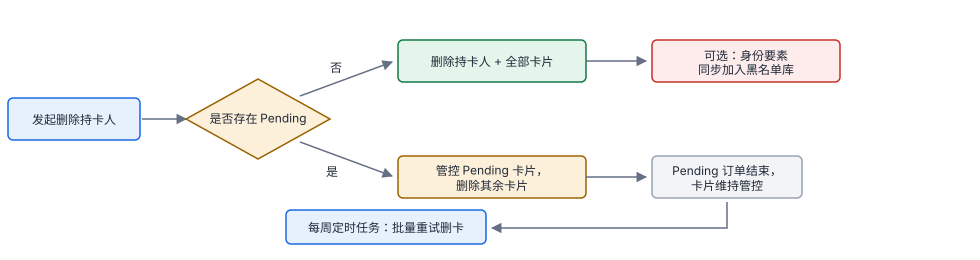
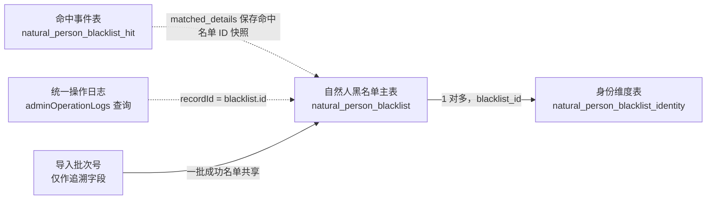
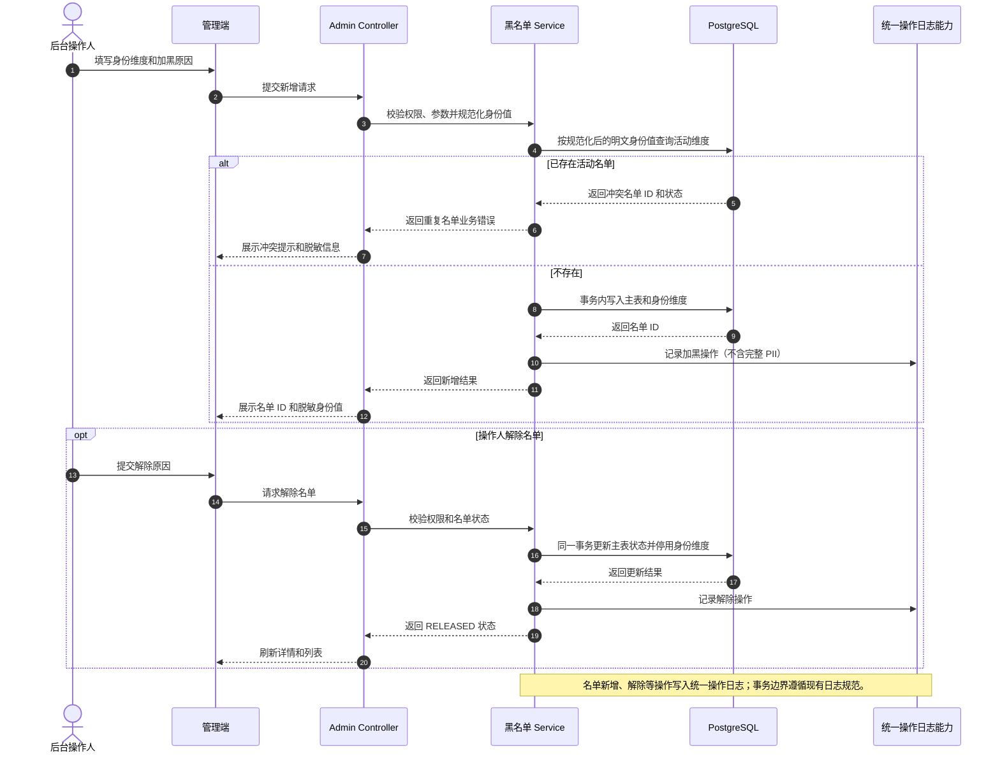
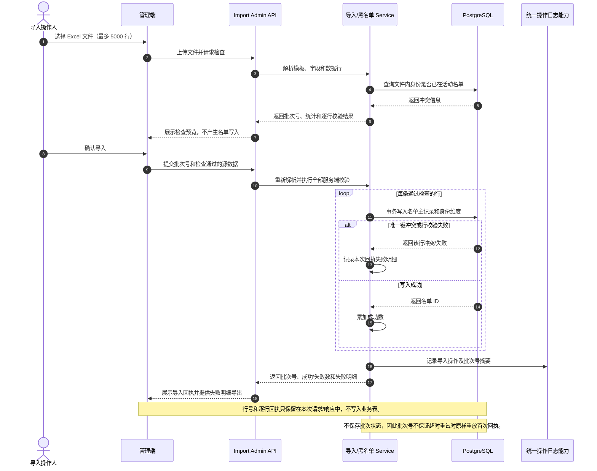
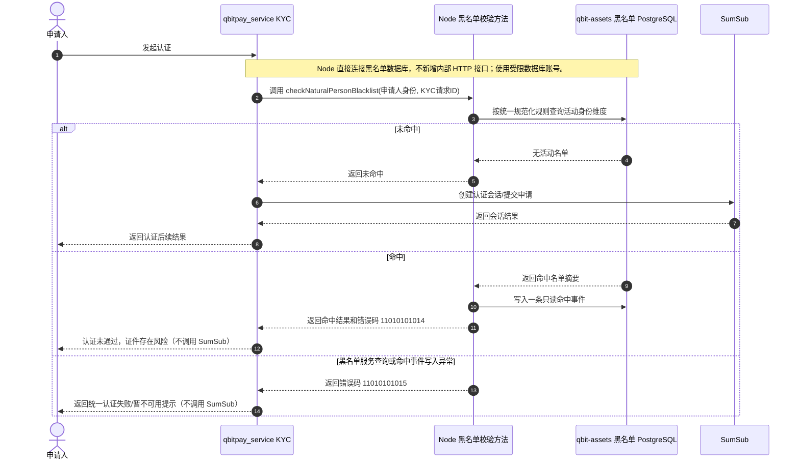
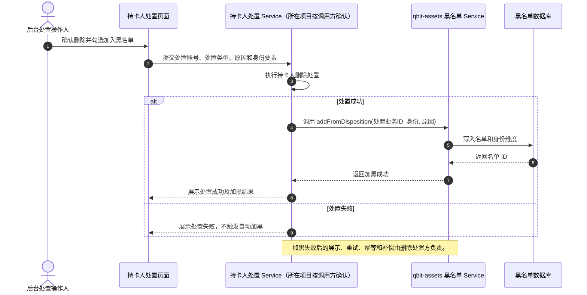

# 自然人黑名单需求分析与开发方案

> 文档状态：方案讨论稿。KYC 在 SumSub 前由 Node 直接查 `public` schema 并写命中事件；身份值在数据库中明文存储，列表和日志仍按脱敏规则返回。
>
> 需求依据：PD-2118 工单、本目录原型、`qbit-assets` 仓库规范，以及用户补充的操作日志接口和导入回执示例。

## 1. 目标与范围

建设独立的自然人黑名单能力，支持名单维护、批量导入、统一操作日志、命中追溯和受控导出。邮箱或国籍/证件维度任一命中时，按确认后的业务规则拒绝后续认证；不回溯已经完成的认证或开卡。

本方案覆盖：

- 名单新增、查询、详情、单条/批量解除。
- Excel 导入检查、确认、同步回执（单次最多 5000 行，逐行部分成功）。
- 命中记录查询，以及与统一操作日志的关联。
- KYC 进入 SumSub 前的实时名单校验和命中记录；由 Node 项目方法直接查询黑名单并写命中事件，不新增 KYC 内部 HTTP 接口。
- 为持卡人删除处置成功后自动加黑提供 qbit-assets Service 方法；删除处置流程的失败处理、重试和补偿由调用方负责。

本方案不实现持卡人筛选、管控、删除和 Pending 卡清理本身；这些属于 PD-2118 的相邻功能。KYC 业务节点和 fail-closed 规则已确认；黑名单表使用 PostgreSQL 默认 `public` schema。处置失败和重试由删除处置调用方负责。

### 1.1 目标用户和使用场景

| 使用者 | 主要操作 | 权限边界 |
|---|---|---|
| 风控/运营后台用户 | 查询名单、手工加黑、解除名单、查看命中和操作历史 | 列表默认脱敏；原文查看入口权限由管理端前端控制 |
| 合规/管理后台用户 | 查看完整身份值、导出明文名单 | 后端提供明文查询和异步导出能力；前端负责入口权限控制 |
| 批量导入操作人 | 上传文件、查看逐行检查结果、确认导入、导出失败行 | 只能确认自己本次检查的文件数据；确认时服务端重新校验 |
| 内部业务服务 | Node KYC 在 SumSub 前调用本地校验方法直接查库并写命中事件；删除处置流程调用 qbit-assets Service 方法 | 删除处置调用方负责加黑失败处理和重试 |

### 1.2 核心对象

- **名单记录**：一次加黑生命周期，包含状态、来源、原因、创建/解除信息和可选业务关联。
- **身份维度**：用于精确匹配的邮箱或国籍/证件组合。一条名单可包含邮箱、证件等多个维度。
- **命中事件**：一次业务请求匹配到一个或多个活动名单后留下的只读审计事件，数据库永久保留。
- **导入批次号**：标识一次文件确认操作，写入该次导入成功的名单记录，用于筛选和追溯；当前不代表一个可查询的批次实体。

### 1.3 名单状态转换

```text
不存在 ──手工新增/导入确认/处置加黑──> ACTIVE ──解除──> RELEASED
                                      RELEASED ──再次加黑──> 新的 ACTIVE 生命周期
```

`RELEASED` 记录保留以支持审计和命中历史追溯。重新加黑创建新的名单 ID，不复用已解除的记录；身份唯一约束只针对未删除且有效的活动维度生效。

## 2. 已确认的设计决定

| 主题 | 当前决定 |
|---|---|
| 数据模型 | 采用 B：自然人黑名单独立模型；不改造旧账户/清算黑名单表的语义 |
| 表数量 | 3 张业务表：名单主表、身份维度表、命中事件表；操作日志复用现有系统 |
| 操作日志 | 复用 `adminOperationLogs(queryParams)`，按 `filter.recordId` 查询；不新增黑名单专用日志查询接口或日志表 |
| 身份匹配 | 邮箱独立匹配；证件维度按“国籍 + 证件类型 + 证件号”匹配；两种维度之间为 OR 命中 |
| KYC 异常策略 | 黑名单校验异常按 fail-closed 处理；命中和系统不可用内部区分，用户侧使用统一认证失败提示，不暴露风控细节 |
| 导入 | 同步检查、同步确认、立即返回回执；当前不支持历史批次回执查询，不建导入批次表 |
| 导入批次号 | 成功导入的名单主记录保存 `importBatchNo`；源文件行号只用于本次检查和回执，不持久化 |
| 导入限制 | Excel 文件，单次最多 5000 行，按行部分成功；操作人不重复提交确认请求，超时后按批次号查询已成功记录 |
| 身份规范化 | 所有输入先去除首尾 Unicode 空白；邮箱和证件号转小写/大写；国籍统一为 ISO 3166-1 alpha-2 大写代码；证件类型使用现有枚举/字典的大写规范代码 |
| 原文查看 | 列表默认脱敏；点击“小眼睛”后调用接口按需获取原文，不在列表响应中批量返回明文；入口权限由前端处理 |
| 导出 | 异步导出，支持明文模式；参考 `POST /admin/balance/snapshot/export` |
| KYC/SumSub | Node 项目在进入 SumSub 前使用本地方法直接查询黑名单表并写入命中事件；命中或校验/命中写入异常均拒绝继续认证，不新增内部 HTTP 接口 |
| 删除处置联动 | qbit-assets 提供领域 Service 方法；失败处理、重试、幂等和补偿由删除处置调用方负责 |
| 命中记录保留 | 命中事件永久保留，不配置自动过期或定期删除 |
| 错误码 | 从 `11010101014` 起按语义顺序分配 6 个码；`id` 由错误码平台生成，类别沿用 `110101` 前缀对应的错误码类型 |
| 操作日志范围 | 统一操作日志按名单 CRUD、导入/导出、原文查询和命中等业务动作分类；KYC 命中详情同时写入命中事件表 |

## 3. 需求分析

### 3.1 名单生命周期

- 名单来源包括人工添加、批量导入、处置联动，分别标记为 `MANUAL`、`IMPORT`、`DISPOSITION`。
- 每条名单记录代表一次加黑生命周期，状态为 `ACTIVE` 或 `RELEASED`。解除保留记录和历史操作，不物理删除。
- 解除后同一身份再次加黑，创建新的名单生命周期；旧名单保持已解除。
- 所有来源的加黑都需要原因备注；处置联动还需保留处置业务信息。

### 3.2 匹配规则

- 邮箱是独立匹配维度，归一化后精确匹配，不要求同时提供证件信息。
- 证件是另一个独立匹配维度，唯一键为“国籍 + 证件类型 + 证件号”，三项组合精确匹配。
- 邮箱维度与证件维度是 OR 关系：任一活动维度命中即命中；同一请求两种维度都命中时归并为一次请求命中事件，并保存全部命中摘要。
- 证件组合缺少国籍、证件类型或证件号时不构成有效证件维度；若同时有有效邮箱，则仍按邮箱维度匹配。

#### 身份规范化规则

匹配、查重和数据库索引一律使用同一份规范化结果，避免导入、管理端和 KYC 各自处理导致命中不一致：

| 字段 | 规范化规则 | 校验要求 |
|---|---|---|
| 所有文本输入 | 去除首尾 Unicode 空白；不自动删除中间空格或标点 | 去除首尾空白后为空则按缺失处理 |
| 邮箱 | 去除首尾空白后使用 `Locale.ROOT` 转小写 | 保留 `+tag`、点号等原有字符；不做 Gmail 等供应商特有别名折叠；按现有邮箱格式校验 |
| 证件号 | 去除首尾空白后使用 `Locale.ROOT` 转大写 | 保留内部空格、连字符、前导零和其他标点；只做证件类型对应的格式校验 |
| 国籍代码 | 去除首尾空白后转大写，统一存储 ISO 3166-1 alpha-2（如 `SG`、`MY`） | 仅接受系统支持的两位国家/地区代码；不接受中文国名或 alpha-3 代码作为匹配键 |
| 证件类型 | 去除首尾空白后转大写 | 只接受现有证件类型枚举/字典中的规范代码；显示名称和别名需先映射成规范代码，未知值拒绝 |

邮箱和证件号不区分大小写；规范化后的值用于精确查重和匹配，身份原文在数据库中明文保存供详情查询和导出。不要对邮箱别名、证件号内部空格/标点做猜测性改写。

### 3.3 管理与审计

- 名单列表支持维度、脱敏维度值、国籍、证件类型、状态、来源、加入时间筛选；展示黑名单 ID、维度、脱敏内容、来源、原因备注、生效时间、状态和操作入口（解除/操作日志/命中记录）。
- 列表默认脱敏；用户点击行内“小眼睛”后调用接口按需查询该身份原文，不在列表响应中返回明文；入口权限由前端处理。
- 支持手工新增、单条/批量解除、名单详情、操作日志和命中记录查询；命中记录直接入库，查询接口沿用现有后台接口认证。
- 支持异步明文导出；前端负责入口权限控制，命中流水只读，不提供人工新增、修改、删除。

### 3.4 批量导入

导入分为“检查”和“确认”两步。检查验证文件格式、必填项、国籍/证件规则、文件内重复和与活动名单的冲突，按源文件行返回结果但不生效。确认时后端重新校验并写入通过的数据，返回批次号、成功/失败数和失败明细。

导入使用 Excel 文件，单次最多 5000 条数据行。前端保留检查数据并在确认时提交；后端不得信任检查阶段的结果，确认时重新校验唯一性和活动名单冲突。采用逐行部分成功：成功行写入，失败行进入本次回执并可导出，不因个别行失败回滚其他成功行。成功名单记录保存 `source=IMPORT` 和 `importBatchNo`；不保留历史回执。

**批次号和行号的区别：** `importBatchNo` 标识一次完整导入，例如 `IMP-20260907-0012`，同一批成功记录共享该值；源文件行号只用于当前检查和失败明细定位，不存入名单主表。

#### 导入的校验范围和结果

检查结果按原文件行号返回。行号从表头后的第一条数据行开始；模板表头、空白行是否计入原始行号，需在前后端对接时统一。单行检查至少包含：

| 校验项 | 处理建议 |
|---|---|
| 文件类型和模板列 | 仅接受 Excel；列名缺失或重复时整文件拒绝并说明原因 |
| 必填项 | 身份维度至少包含邮箱或完整证件组合；加黑原因必填，长度不超过 255 |
| 格式和规范化 | 邮箱和证件号比较不区分大小写；实现时去除首尾空格，国籍和证件类型按现有规范代码校验 |
| 文件内重复 | 按文件顺序检查：首条合法记录作为写入候选，后续相同匹配键的行作为单行失败；失败行不写入，其他有效行照常导入 |
| 当前活动名单冲突 | 与活动名单匹配时标记失败，并返回脱敏的冲突说明；不可在检查阶段修改既有名单 |
| 无效行 | 逐行返回字段级或行级原因；单行错误不阻止其他有效行继续预览 |

检查阶段不写名单主表、身份维度或命中事件，也不写操作日志。整文件无法解析、超过配置的文件上限或缺少必要列时，返回文件级错误，不返回虚假的逐行成功结果。

#### 检查与确认之间的数据传递

当前设计不保存服务端检查快照。前端在确认时提交检查通过的原始行数据、`importBatchNo` 及必要的请求校验信息；服务端对数据重新解析和校验，不接受前端传来的“已通过”标记作为可信依据。文件摘要是否加入确认请求以检测用户在预览后换文件，属于接口评审要定的细节。

由于不保存批次状态，批次号只提供成功记录的归属追溯，不单独构成严格的请求幂等保证。操作人确认提交后不应重复提交；前端需防止重复点击。确认请求超时后，先按批次号查询已成功写入的名单，不重新提交；失败回执因当前不持久化而无法恢复。若后续要求原样返回首次回执或查询历史失败明细，再评估增加批次状态持久化（是否建批次表届时另行评审）。

#### 部分成功策略

采用逐行部分成功：无效行进入失败明细，有效行独立写入；任一行发生唯一键冲突或数据库写入失败，该行失败，不影响其他独立行。每一行生成名单和其全部身份维度应处于同一事务边界；一行同时包含邮箱和证件时，两个身份维度必须同时成功或同时回滚，禁止留下不完整名单。每行结果按原文件行号回填至本次回执。

### 3.5 KYC/SumSub 与处置联动

**KYC 业务规则和调用方式已确认：** 持卡人提交 KYC 认证时，在进入 SumSub 节点前实时检查邮箱和证件身份。由 Node 项目 `qbitpay_service` 的本地方法直接查询黑名单数据；任一维度命中活动名单时写入命中事件，再拒绝本次认证，不创建/提交 SumSub 认证，并向用户返回统一话术“认证未通过，证件存在风险”，不返回命中名单来源、规则或其他风控细节。名单查询或命中事件写入异常均按 fail-closed 处理，不继续认证。

该方案不新增 KYC 黑名单内部 HTTP API。qbit-assets 负责 `public` schema 下黑名单表结构和迁移；Node 使用自己的 Repository/数据访问方法读取活动身份维度并写入命中事件。Node 项目已有 TypeORM 和 PostgreSQL 驱动。查询失败或命中事件写入失败均按 fail-closed 阻断认证，内部区分命中与系统异常。

**删除处置联动方式已确认：** qbit-assets 提供黑名单领域 Service 方法供删除处置调用；加黑失败后的展示、重试、幂等和补偿均由删除处置调用方负责，本需求不设计这些调用方机制。

#### 原型中的持卡人删除流程（关联范围，本期暂不实现）

该流程用于说明删除持卡人功能与黑名单的关联位置。持卡人删除、Pending 卡片处理和定时重试不属于本次黑名单开发范围；流程中的“可选同步加入黑名单库”由 qbit-assets Service 方法承接，Service 返回的加黑结果由删除处置方负责后续处理。



### 3.6 非功能要求

- **数据存储**：身份原文在数据库中明文保存；列表和命中记录接口默认脱敏，详情查询和异步导出按接口契约返回原文。应用日志、异常堆栈和统一操作日志不得输出完整邮箱或证件号。
- **权限边界**：本需求提供单条不脱敏查询接口和异步导出能力；原文查看和明文导出入口权限由管理端前端处理，不在本服务新增专用按钮权限设计。
- **一致性**：主表状态与身份维度 `active` 在同一事务内变更；唯一索引作为并发写入的最终防线。
- **可追溯**：名单 CRUD、导入确认、KYC 命中校验和导出按现有统一操作日志记录；命中校验另写只读命中事件。日志不得包含完整邮箱或证件号。
- **性能**：列表、精确身份匹配和命中查询均使用索引/数据库分页；JSONB 查询索引方案需以实际查询条件验证。
- **保留策略**：命中事件在数据库永久保留，不设置自动过期和定期删除；命中详情仅返回脱敏摘要。

## 4. 当前实现背景与边界

- `qbit-assets` 后端为 Java 17、Spring Boot 3、MyBatis-Plus、PostgreSQL；管理入口按本仓库 Admin Controller/Service 分层实现。
- `qbit-assets` 已有 `BlackListMain`、`BlackListElement`、`BlackListMainElement` 及清算相关调用。旧模型和消费者不能表达本需求的独立状态、来源及命中审计，因此新功能使用独立表，不改变旧清算逻辑。
- 实际个人 KYC 编排在 `/Users/martinjiang/WebstormProjects/qbitpay_service`。该项目使用 TypeORM 和 PostgreSQL 驱动，可在 Node 侧实现查询及命中写入方法；黑名单表由 qbit-assets 建在 PostgreSQL 默认 `public` schema，Node 侧只实现访问逻辑，不新增黑名单内部 HTTP API。
- 管理端前端不在 `qbit-assets` 仓库。本方案定义后端能力和字段契约，UI 按 PD-2118 原型对接。
- 用户提供的统一操作日志调用使用 `/admin-graphql` 下的 `adminOperationLogs(queryParams)`。黑名单操作写入统一日志后，以名单 ID 作为 `recordId` 查询。

## 5. 方案比较

| 方案 | 做法 | 主要取舍 |
|---|---|---|
| A. 扩展旧表 | 在旧黑名单表上增加自然人字段和状态 | 初期表少，但会把账户/清算名单与自然人 KYC 规则耦合，旧消费者回归风险高 |
| B. 独立模型 | 新建自然人主表、身份维度和命中事件 | 数据边界清楚，解除、重加黑和命中审计可独立处理；需要新增表和服务 |
| C. 旧表存匹配值、新表存管理信息 | 旧匹配表与新管理表双写/关联 | 会引入状态同步、跨表唯一性和补偿复杂度 |

**选择 B。** 用户已确认。旧账户和清算黑名单保持现有含义；自然人名单只通过新领域服务管理和匹配。

## 6. 数据模型

建议新增 3 张业务表。每张表必须包含统一必备列：`id bigint primary key not null`、`remarks varchar(255)`、`create_time timestamptz not null default now()`、`update_time timestamptz not null default now()`、`delete_time timestamptz`、`version integer not null`。这里的“必备”指每张表都要有这些列；是否允许 NULL 按给出的 DDL 定义执行（示例中 `remarks` 和 `delete_time` 未声明 `not null`）。业务字段在此基础上扩展。所有表和字段使用 PostgreSQL 中文 `COMMENT`；软删除字段查询遵循仓库约定；不创建物理外键。

以下字段清单按 PostgreSQL 默认 `public` schema 下的物理列名（`snake_case`）描述，不是可直接执行的最终 DDL；Java 实体属性使用 `camelCase` 并按项目规范映射。物理表名建议使用 `snake_case`。ID 由项目统一 ID 生成器提供。`remarks` 按公共表结构保留，名单主表将其作为必填加黑原因；其他表按业务用途填写或置空。各表的 `delete_time IS NULL` 是默认有效记录条件，不能以 `version` 替代业务状态。

### 6.1 名单主表 `natural_person_blacklist`（实体：`NaturalPersonBlacklist`）

| 字段 | 用途 |
|---|---|
| `id` | 名单生命周期 ID，`bigint` 主键 |
| `status` | `ACTIVE` / `RELEASED` |
| `source` | `MANUAL` / `IMPORT` / `DISPOSITION` |
| `remarks` | 必填加黑原因，`varchar(255)`；作为公共必填字段使用 |
| `source_business_type`、`source_business_id` | 关联处置业务类型和业务 ID；非处置来源可为空 |
| `import_batch_no` | 仅 `source=IMPORT` 时填写，关联业务批次号；其他来源为空 |
| `created_user_id`、`released_user_id`、`released_time` | 加黑/解除操作人 user ID 和解除时间 |
| `create_time`、`update_time`、`delete_time`、`version` | 公共必填字段；时间类型及默认值按统一定义 |

**建议约束与索引**

- 主键：`id`，`bigint`，由项目统一 ID 生成器赋值。
- 列表索引：建议覆盖 `status, source, create_time`；若常用条件还包含来源和状态组合，结合查询计划调整索引次序。
- 导入追溯索引：`import_batch_no`，用于按批次号筛选成功导入的名单。
- 处置来源：保存可用的处置业务类型和业务 ID 供追溯；调用方负责重复调用、重试和幂等控制，本服务不以处置业务 ID 承诺调用幂等。
- 业务校验：`source=IMPORT` 时 `import_batch_no` 必须有值；其他来源为空。若 CHECK 约束与项目迁移规范兼容，可落到数据库约束。
- 状态更新：解除时仅允许 `ACTIVE -> RELEASED`；重复解除返回“已解除”业务结果，不重复停用身份值或重复写成功日志。

邮箱、证件值不直接放在主表中，身份维度独立存储。同一名单可关联邮箱和证件组合中的一个或多个维度。

### 6.2 身份维度表 `natural_person_blacklist_identity`（实体：`NaturalPersonBlacklistIdentity`）

| 字段 | 用途 |
|---|---|
| `id`、`blacklist_id` | 维度记录 `id` 为 `bigint` 主键；`blacklist_id` 为所属名单 ID，应用层维护关联，不建物理外键 |
| `identity_type` | `EMAIL` / `NATIONALITY_ID` |
| `country_code`、`id_type` | 国籍代码和证件类型；与证件号共同构成证件身份唯一键 |
| `identity_value` | 邮箱或证件号原文，数据库明文保存；详情和导出接口按需返回 |
| `normalized_value` | 按统一规则规范化后的邮箱或证件号，供精确匹配和唯一约束 |
| `masked_value` | 后台列表脱敏展示值 |
| `active` | 维度是否参与匹配；解除名单时与主记录在同一事务中停用 |
| 公共字段 | `remarks varchar(255)`、`create_time timestamptz not null default now()`、`update_time timestamptz not null default now()`、`delete_time timestamptz`、`version integer not null` |

活动维度需建立唯一约束：邮箱规范化值单独唯一；或国籍代码 + 证件类型 + 证件号规范化值组合唯一。并发重复以数据库唯一索引兜底，应用层返回可读冲突信息。身份值按当前决定明文保存，列表和日志不得输出完整身份值。

**字段/唯一键细化**

- `identity_type=EMAIL`：`country_code`、`id_type` 可空；邮箱作为独立维度，以 `normalized_value` 精确匹配。
- `identity_type=NATIONALITY_ID`：`country_code`、`id_type`、规范化证件号必填；唯一键固定包含国籍、证件类型和规范化证件号。
- `normalized_value` 存储对应维度规范化后的明文值，写入前由服务统一规范化；邮箱和证件号按已确认规则转小写/大写。
- `identity_value` 保存原始身份值，用于详情查询和导出；列表、命中记录及普通日志使用脱敏值。
- PostgreSQL 部分唯一索引只对 `active=true AND delete_time IS NULL` 的记录生效。解除时将 `active=false`，之后允许重新建立相同身份的新生命周期。

**推荐索引**

| 索引 | 用途 |
|---|---|
| EMAIL 活动维度部分唯一索引 | `(normalized_value)` 唯一，条件为 `identity_type='EMAIL' AND active=true AND delete_time IS NULL` |
| NATIONALITY_ID 活动维度部分唯一索引 | `(country_code, id_type, normalized_value)` 唯一，条件为 `identity_type='NATIONALITY_ID' AND active=true AND delete_time IS NULL` |
| `(blacklist_id)` | 名单详情查身份维度、解除时停用关联维度 |
| `(identity_type, normalized_value)` 普通查询索引 | 供命中检查定位活动名单；若同列已有部分唯一索引，避免重复建索引 |

### 6.3 命中事件表 `natural_person_blacklist_hit`（实体：`NaturalPersonBlacklistHit`）

| 字段 | 用途 |
|---|---|
| `id` | 命中事件 `bigint` 主键 |
| `source_system`、`request_id` | 来源服务和请求 ID；组合唯一，防重复写入 |
| `scene`、`source_type` | 命中场景和 KYC 来源；枚举待接口评审 |
| `account_id`、`merchant_id`、`cardholder_id` | 请求主体上下文；尚未生成的持卡人 ID 允许为空 |
| `matched_details`（JSONB） | 命中名单 ID、命中维度、脱敏值及来源快照；一条请求事件容纳多个命中结果 |
| `result_code`、`occurred_at` | 拦截结果及业务发生时间；另包含公共必填字段 `remarks`、`create_time`、`update_time`、`delete_time`、`version` |

命中事件只允许查询和导出，不提供更新、删除接口，且数据库永久保留。按名单 ID 查询通过 `matched_details` 的 JSONB 索引支持。不得把完整邮箱或证件号写入普通日志。

**写入和查询规则**

- 一次校验请求最多写一条命中事件；若命中多个名单或多个身份维度，将所有命中摘要放入 `matched_details` 数组。
- `request_id` 使用稳定的 KYC 认证请求 ID；`source_system=qbitpay_service` 与 `request_id` 组合唯一，用于 Node 方法重试时去重。
- 命中事件需保存命中时的名单 ID、来源、命中维度、脱敏匹配摘要、校验场景和结果，避免后续名单被解除后历史记录失去解释能力。
- 该表包含公共必填字段；`remarks` 可记录简短业务说明，不重复存放完整请求报文或 PII。
- 命中详情查询需要支持按时间、来源系统、场景、账户/主体标识筛选；按名单 ID 查询的 JSONB 路径及 GIN/表达式索引需根据最终 JSON 结构确定。

### 6.4 数据关系图

以下是应用层的逻辑关系，不表示数据库物理外键。操作日志由现有统一日志能力保存；`recordId` 指向名单 ID。



### 6.5 操作日志

不建黑名单专属操作日志表，复用现有统一操作日志能力。加黑、解除等写操作按统一日志格式记录；`recordId` 使用稳定名单 ID，不使用导入批次号。操作日志与命中事件分开：操作日志说明谁做了什么，命中事件说明哪个请求命中了什么。

**日志范围已确认：** 统一操作日志记录名单新增、导入、处置加黑、单条/批量解除、原文查看、导出，以及 KYC 命中等黑名单业务操作；业务类型按名单 CRUD、导入/导出、命中等动作区分，不另设待确认项。管理端按名单 ID 作为 `recordId`，通过 `adminOperationLogs(queryParams)` 和 `filter.recordId` 查询名单相关历史。KYC 命中同时写入永久保留的命中事件表；命中事件表是业务命中明细，统一操作日志用于记录操作行为。日志不保存完整邮箱或证件号。

## 7. 接口清单

下表中的 REST 路径为业务接口草案，最终按接口所属项目的既有协议落地。操作日志复用统一 GraphQL 查询。KYC 通过 Node 本地方法直接访问数据库，不新增黑名单 HTTP 接口；删除处置只提供 qbit-assets Service 方法。

| 类别 | 接口 | 用途 | 状态 |
|---|---|---|---|
| 名单管理 | `GET /admin/natural-person-blacklists` | 分页查询和筛选名单 | 新增 |
| 名单管理 | `GET /admin/natural-person-blacklists/{id}` | 查看名单详情，身份值脱敏 | 新增 |
| 名单管理 | `GET /admin/natural-person-blacklists/{id}/identities/{identityId}/reveal`（路径草案） | 行内“小眼睛”查看单条身份原文；管理端前端控制入口权限 | 新增，路径待遵循项目现有接口规范 |
| 名单管理 | `POST /admin/natural-person-blacklists` | 手工加黑，返回名单 ID 或重复/校验错误 | 新增 |
| 名单管理 | `POST /admin/natural-person-blacklists/{id}/release` | 解除单条有效名单 | 新增 |
| 名单管理 | `POST /admin/natural-person-blacklists/batch-release` | 批量解除并逐条返回结果 | 新增 |
| 操作日志 | `adminOperationLogs(queryParams)`，`filter.recordId = 名单 ID` | 查看名单的加黑/解除操作历史 | 复用，不新增专用接口 |
| 命中记录 | `GET /admin/natural-person-blacklists/{id}/hits` | 分页查看指定名单命中流水 | 新增 |
| 批量导入 | `POST /admin/natural-person-blacklist-imports/check` | 上传 Excel 并检查文件，返回批次号及逐行检查结果；最多 5000 行，不写有效名单 | 新增 |
| 批量导入 | `POST /admin/natural-person-blacklist-imports/confirm` | 提交检查通过的数据和批次号；后端重检后写入，返回同步回执 | 新增 |
| 批量导入 | 模板下载 | 下载 Excel 模板 | 可用静态文件；动态生成时再加接口 |
| 导出 | `POST /admin/natural-person-blacklists/export` | 按筛选条件异步导出；参考余额日终异步导出模式，完成后通知下载 | 新增 |
| KYC/SumSub | Node 本地方法 `checkNaturalPersonBlacklist(...)`（方法名草案） | Node 在提交 SumSub 前直接查 `public` schema 活动身份维度；命中时写 `natural_person_blacklist_hit` 并拒绝认证 | 业务方案已确认；不新增 HTTP API |
| 删除处置联动 | qbit-assets 内部 `addFromDisposition(...)` Service 方法 | 删除处置成功且满足加黑条件后，按处置业务信息加黑 | qbit-assets 提供 Service；失败处理、重试和补偿由删除处置调用方负责 |

导入检查响应中的行号只用于当次预览和失败明细，不保存至名单主表。确认接口同步返回批次号、成功/失败数及失败明细；当前不新增历史回执查询接口。若后续确认需要异步导入或历史回执查询，再补充批次表和查询接口。

### 7.1 接口草案字段

所有接口先遵循后台可信身份和现有分页规范；具体 URI、HTTP/GraphQL 入口、响应包络、权限码以管理端和 Admin API 现有约定为准。下面字段用于前后端评审，不代表最终 OpenAPI schema。

| 接口 | 请求要点 | 响应要点 | 主要校验/结果 |
|---|---|---|---|
| 名单分页查询 | `page`、`size`；`status`、`source`、`identityType`、`countryCode`、脱敏值关键词、`importBatchNo`、创建时间范围 | 名单 ID、状态、来源、脱敏身份维度、备注、创建人/时间、导入批次号 | 默认不返回原文；分页由数据库执行；只查询 `delete_time IS NULL` |
| 名单详情 | 路径名单 ID | 名单字段、脱敏身份维度、解除信息 | 默认只返回脱敏值；不随详情批量返回原文 |
| 查看身份原文 | 名单 ID + 身份维度 ID | 单条身份原文 | 行内“小眼睛”触发；入口权限由管理端前端控制 |
| 手工新增 | 邮箱/证件维度、国籍/证件类型、原因备注 | 新名单 ID、状态、脱敏维度 | 至少一个完整维度；原因必填；活动身份冲突拒绝；一条名单及其多个维度原子写入 |
| 单条解除 | 名单 ID、解除原因/备注 | 最终状态、解除时间 | 仅活动名单可解除；重复请求按幂等业务结果返回；主表和身份维度同事务更新 |
| 批量解除 | 名单 ID 列表、解除原因 | 每个 ID 的成功/失败状态和失败原因，另含汇总数量 | 去重 ID；建议限制单次数量；逐条给出不存在、已解除、权限或并发冲突结果 |
| 命中记录分页 | 名单 ID或筛选条件、分页和时间范围 | 命中时间、请求来源、场景、结果、命中维度摘要 | 只读；返回脱敏数据；无完整身份原文 |
| 导入检查 | Excel 文件；解析选项（如模板版本） | 批次号、行数统计、逐行状态/错误码/错误文案/冲突摘要 | 最多 5000 行；文件级错误与行级错误区分；不写业务表 |
| 导入确认 | 批次号、检查通过行的源数据，必要时含文件摘要 | 批次号、成功数、失败数、成功名单 ID（可选）、失败行及原因 | 服务端重检；逐行部分成功；前端防重复点击，操作人不重复提交；同步返回本次回执 |
| 导出 | 与名单查询相同的筛选条件、脱敏/明文模式 | 受理异步任务；完成后通过现有通知推送文件下载链接 | 参考 `POST /admin/balance/snapshot/export`；前端负责导出入口权限 |

**异步导出实现参考：** 当前余额日终导出由 Admin Controller 调用 `BalanceSumService.asyncExportSnapshot`，再按 `ExportEnum.SNAPSHOT_CURRENCY_BALANCE` 选择 `ReportFactory` 中的报表处理器。处理器异步生成文件、上传到对象存储，并通过现有 WebSocket 通知推送下载链接；失败时推送失败通知。黑名单导出复用这套报表策略和通知方式，新增对应的导出类型及处理器，不在 HTTP 响应中同步返回文件流。明文导出入口权限由前端处理。

### 7.2 导入检查/确认数据示例

以下仅为字段形状示例，枚举和错误码需在接口评审时统一：

```json
{
  "importBatchNo": "IMP-20260907-0012",
  "totalRows": 128,
  "validRows": 124,
  "invalidRows": 4,
  "rows": [
    {
      "rowNo": 2,
      "status": "VALID",
      "errors": [],
      "maskedIdentity": "a***@example.com"
    },
    {
      "rowNo": 3,
      "status": "INVALID",
      "errors": [
        {"field": "remarks", "code": "REQUIRED", "message": "加黑原因不能为空"}
      ]
    }
  ]
}
```

确认回执沿用原型所示的成功数、失败数、批次号和失败明细；是否返回成功明细名单 ID 由前端是否需要继续查看详情决定。源文件行号只存在于当次响应，不落库。

### 7.3 错误处理建议

| 场景 | 建议业务结果 |
|---|---|
| 身份维度不完整或格式错误 | 参数校验失败，说明具体字段；不写入 |
| 活动名单已存在 | 冲突结果，返回冲突记录 ID 和脱敏值（在权限允许时） |
| 名单已经解除 | 解除接口返回“已解除”状态，不再次变更 |
| 批量请求部分失败 | 返回逐项结果，不把失败原因只写入服务端日志 |
| 导入文件整体不可读 | 文件级错误，不生成部分成功记录 |
| 导入确认发生并发唯一冲突 | 当前行失败并返回可理解冲突原因；其余行按部分成功策略处理 |
| 依赖服务或数据库异常 | 使用项目统一业务异常和错误码；保留业务 ID、请求 ID等定位信息，不记录 PII |

**黑名单校验异常策略已确认：fail-closed。** KYC 查询名单失败、超时或无法确认命中结果时，当前请求不继续进入后续认证；需返回专用业务错误并记录可定位日志，不能把系统异常伪装成“命中黑名单”。命中时对客统一返回“认证未通过，证件存在风险”；校验服务异常也不得向用户暴露黑名单细节，内部使用单独错误语义：命中使用 `11010101014`，校验不可用使用 `11010101015`。用户给出的 `CODE_11011600059` 当前含义是“日账单查询仅支持最近 90 天”，不得复用。

### 7.4 建议错误码清单

错误码 `11010101013` 已被占用，本功能从 `11010101014` 起按语义顺序连续分配。qbit-assets 常量按 `CODE_` 前缀命名；Node 将内部错误映射为认证响应。`11011600059` 已用于“日账单查询仅支持最近 90 天”，与本功能无关，不复用。

| 数字码 | 语义常量 | 场景和处理 | 提示建议 |
|---|---|---|---|
| `11010101014` | `NATURAL_PERSON_BLACKLIST_HIT` | 活动名单命中；拒绝认证，不调用 SumSub | `认证未通过，证件存在风险`；不得透露命中名单和风控细节 |
| `11010101015` | `NATURAL_PERSON_BLACKLIST_CHECK_UNAVAILABLE` | 名单查询或命中事件写入异常；fail-closed | 认证暂不可用提示；内部与实际命中区分 |
| `11010101016` | `NATURAL_PERSON_BLACKLIST_IDENTITY_CONFLICT` | 手工新增/导入与活动名单冲突；HTTP 409 或行级失败 | 后台返回冲突记录 ID 和脱敏值 |
| `11010101017` | `NATURAL_PERSON_BLACKLIST_IDENTITY_INVALID` | 身份维度不完整或格式错误；HTTP 400 或行级失败 | 指明邮箱、国籍、证件类型或证件号错误 |
| `11010101018` | `NATURAL_PERSON_BLACKLIST_IMPORT_FILE_INVALID` | Excel 解析、模板或行数错误；整文件拒绝 | 返回文件级错误原因 |
| `11010101019` | `NATURAL_PERSON_BLACKLIST_RECORD_NOT_FOUND` | 名单 ID 不存在或已软删除；HTTP 404 | 返回名单记录不存在 |

字段必填、权限不足、已解除等情况优先复用项目现有参数校验、权限和状态冲突错误码；导出异步失败沿用现有失败通知，不额外造同步 HTTP 错误码。

错误码配置草案按现有错误码导出结构整理，包含上述 6 个数字码及 QBIT、Interlace 的中英文提示，见[自然人黑名单-错误码配置草案.json](./自然人黑名单-错误码配置草案.json)。数字码按用户确认从 `11010101014` 连续编至 `11010101019`；数据库 ID 仍由错误码平台生成。导入前核实 `common` 类型 ID 与品牌语言配置方式。

## 8. 关键业务流程

本节时序图用于明确参与方和先后顺序。管理端、导入流程及 KYC 在 SumSub 前由 Node 直接访问黑名单数据库的业务方式已经确认；数据库共享访问和部署权限需在联调前核实。

### 8.1 新增与解除

1. 校验请求和加黑原因，规范化身份值。
2. 查询活动身份维度；重复时返回冲突名单信息。
3. 同一事务写入名单主表、身份维度和统一操作日志。
4. 解除时将主表改为 `RELEASED`，并停用全部身份维度；写操作日志，保留命中历史。

**并发处理要求：** 应用层先查重用于提供友好错误；数据库唯一索引负责最终并发保护。若插入维度唯一键冲突，事务回滚该名单的全部记录并转换为重复名单业务错误。解除操作按 `id + status=ACTIVE + delete_time IS NULL` 条件更新，使用受影响行数判断并发状态变化；不得先释放身份唯一值、再异步改名单状态。

#### 手工加黑与解除时序图



### 8.2 导入检查与确认

1. 检查接口解析文件，逐行校验必填、格式、证件字段、文件内重复和当前活动名单冲突；返回 `importBatchNo`、源文件行号、通过/失败状态和原因，不落入有效名单。
2. 前端保留待确认数据。确认接口提交同一批数据及 `importBatchNo`。
3. 后端重新校验并逐行写入通过数据；每条成功名单记录写入 `source=IMPORT`、`importBatchNo` 和原因备注。
4. 同步返回成功数、失败数和失败行明细；失败明细由前端导出。批次号用于追溯，活动身份唯一约束防止重复有效名单。

**原型步骤对应关系：**

| 原型步骤 | 服务端行为 | 前端展示 |
|---|---|---|
| 上传文件 | 接收文件并检查格式、模板和权限 | 上传进度及文件级错误 |
| 校验预览 | 返回逐行校验结果，不改变有效名单 | 有效/失败数量、失败原因和确认入口 |
| 导入回执 | 确认并写入；返回实际成功/失败数和批次号 | 批次号、成功/失败总数、失败明细导出 |

检查页的预计成功数不等于最终写入数。确认时如果名单并发变化，最终回执以服务端写入结果为准，不能直接沿用预览统计。

#### 批量导入检查与确认时序图



### 8.3 KYC 命中

持卡人提交 KYC 认证时，在进入 SumSub 节点前实时查询活动名单。邮箱或“国籍 + 证件类型 + 证件号”任一维度命中即先写入一条命中事件，再拒绝认证，不调用 SumSub。对客命中话术为“认证未通过，证件存在风险”，不暴露命中规则、来源或名单信息。命中事件数据库永久保留。

#### KYC/SumSub 前置校验时序图（Node 本地方法直连数据库）



该图是已确认业务行为示意。名单查询或命中事件写入异常按 fail-closed 处理；数据库连接和账号权限在 Node 与 qbit-assets 联调时核实。

#### 删除处置自动加黑时序图（Service 边界和失败责任方已确认）



## 9. 开发计划

### 阶段 0：确认开发前置项

- 使用已定义的规范化规则：去除首尾 Unicode 空白，邮箱转小写、证件号/国籍/证件类型代码转大写；核对国籍与证件类型字典。
- 数据库明文保存身份值；Java 与 Node 按本方案使用相同的规范化规则查询。
- Excel、单次 5000 行上限和逐行部分成功已确认；单行问题不入库，文件内按顺序保留首个合法行、后续重复行失败。
- 黑名单表使用 PostgreSQL 默认 `public` schema；无 KYC 内部 HTTP API。删除处置失败、重试和幂等由调用方处理。
- 错误码 `11010101013` 已占用，本需求固定使用 `11010101014`–`11010101019`；实现时按语义配置 Java 常量，并将配置草案中的平台类型 ID、记录 ID 和品牌语言配置核对后导入。

### 阶段 1：名单数据和领域服务

- 创建三张表及索引，所有表包含统一必填公共字段，添加全部中文表/字段注释。
- 实现身份规范化、活动维度查询、冲突检测、加黑/解除领域服务。
- 复用统一操作日志；黑名单表及迁移由 qbit-assets 管理，Node 项目实现本地方法直查活动名单并写命中事件。

### 阶段 2：管理端接口

- 实现分页查询、详情、手工加黑、单条/批量解除。
- 实现名单与统一操作日志、命中流水查询。
- 实现列表脱敏、单条身份原文查询和异步明文导出；原文查看及导出入口权限由前端处理。

### 阶段 3：导入和导出

- 实现 Excel 检查（最多 5000 行）、逐行结果、确认重检、部分成功回执和失败明细导出。
- 成功名单记录保存批次号；不创建导入批次/行表。
- 实现脱敏/明文名单异步导出；入口权限由前端处理。

### 阶段 4：跨项目数据库联调

- Node 在默认 `public` schema 读取名单与身份维度并写入命中事件；对齐 Node 与 Java 的身份规范化、字段映射和错误码语义。
- 删除处置方接入 qbit-assets `addFromDisposition(...)` Service；失败处理、重试、幂等和补偿均由调用方负责。

### 阶段 5：联调和验收

- 覆盖活动名单匹配、已解除放行、重复加黑、并发唯一性、导入检查/部分失败/重试和明文权限。
- KYC 需验证 Node 查询、命中事件成功落库及命中写入失败时 fail-closed；删除处置调用方自行验证其重试和幂等行为。
- 按仓库要求完成目标测试、编译/verify 和 `git diff --check`；不自动提交或创建 PR。

### 9.1 建议任务拆分及交付物

| 任务 | 主要产出 | 依赖/退出条件 |
|---|---|---|
| 需求与接口评审 | 身份唯一键、导入策略、权限、错误码确认记录 | 数字错误码固定为 `11010101014`–`11010101019`；核实错误码配置类型/ID |
| 数据库迁移 | 三张表、索引、约束、中文注释、回滚说明 | DDL 通过目标 PostgreSQL 版本验证 |
| 领域规则 | 身份规范化、明文精确查重、生命周期状态转换 | 单测覆盖规范化和冲突边界 |
| 名单管理 API | 分页、详情、新增、解除、批量解除 | 后台认证、脱敏、统一日志均联调通过 |
| 导入 API | 文件解析、检查预览、确认重检、回执 | 文件上限和部分失败策略已定 |
| 命中查询能力 | 命中表查询、分页和脱敏展示 | KYC 命中写入时机已确认为 SumSub 前实时校验 |
| 导出 | 筛选导出、明文查询及异步导出 | 明文查询接口、导出任务和统一操作日志联调通过；入口权限由前端处理 |
| 管理端联调 | 页面字段、空态、重复冲突、导入三步 | 前端契约和回执字段冻结 |
| 发布准备 | 迁移、配置、权限、监控和回滚步骤 | Node 使用 `public` schema；旧黑名单消费者无行为变化 |

### 9.2 发布与回滚

- 采用新增表和新增接口发布，不修改旧清算黑名单数据及其消费者。
- 发布前确认数据库迁移、ID 生成、前端入口配置和操作日志写入方式。
- 建议先发布黑名单表和管理能力，再开启前端入口；Node KYC 直连和处置 Service 在对应项目联调完成后启用。
- 回滚应用版本不应删除已经写入的名单、身份或命中数据；数据结构回滚是否允许删表需另行评审，默认保留数据并通过版本回退停止新入口。
- 监控至少关注：加黑/解除成功失败数、身份唯一冲突数、导入行数及失败率、导出次数、敏感查看次数、命中查询耗时及依赖失败。

## 10. 待确认事项

| 优先级 | 决策 | 建议 |
|---|---|---|
| P1 | 错误码配置导入 | 6 个数字码已分配为 `11010101014`–`11010101019`；导入前核实 `common` 类型 ID、数据库记录 ID 生成及品牌/语言落库要求 |

其余业务决策已确认：名单表使用默认 `public` schema；数据库明文保存身份值，匹配使用规范化明文精确比较；原文查询及明文导出入口权限由前端处理；删除处置的失败处理、重试、幂等和补偿由调用方负责；统一操作日志按名单 CRUD、导入/导出和命中等动作分类。Excel 单次最多 5000 行、逐行部分成功；单行有问题不写入且不影响其他行；KYC 在 SumSub 前由 Node 直接查库、命中拒绝和 fail-closed；命中记录永久入库。文件内重复按文件顺序保留首个合法行，后续重复行作为失败行处理。

## 11. 验收标准

- 名单按邮箱或确认后的国籍/证件组合精确匹配；解除名单不参与匹配。
- 新增、解除和批量导入成功记录都能追溯来源及加黑原因；操作日志按名单 ID 查询。
- 单次请求命中多个维度时只保存一条命中事件，并列出命中名单和维度；命中流水不可人工修改或删除。
- 导入检查不产生有效名单；确认时重新校验；同步回执正确返回成功/失败数和失败原因。
- 列表和命中详情默认脱敏；原文详情及明文导出由接口提供，入口权限由前端处理。
- 旧账户/清算黑名单行为不改变。
- KYC/SumSub 验收 Node 查询、命中落库及 fail-closed；删除处置调用方负责失败展示、重试、幂等和补偿。

### 11.1 建议测试场景

| 模块 | 场景 | 预期 |
|---|---|---|
| 身份匹配 | 邮箱大小写/空格规范化后精确命中 | 规范化规则相同则命中；不同身份不得误命中 |
| 身份匹配 | 仅邮箱命中、仅证件命中、两者都命中 | 返回命中维度；多个维度命中仍按一次请求写一条命中事件 |
| 生命周期 | 活动名单解除后再次检查 | 不再命中；历史命中和名单记录仍可查询 |
| 生命周期 | 解除后以同一身份再次加黑 | 新建名单生命周期，旧记录保持 RELEASED |
| 并发 | 两个请求同时添加相同活动身份 | 最多一个成功；另一个返回重复冲突，不残留孤立主表/维度 |
| 权限 | 无原文权限查看详情或导出 | 只返回脱敏值或拒绝明文模式，并写审计 |
| 导入检查 | 文件格式错误、模板列缺失 | 返回文件级错误，不写任何名单数据 |
| 导入检查 | 单行必填错误、格式错误、文件内重复 | 行级错误位置和原因准确，检查过程不生效 |
| 导入确认 | 预览后名单已被其他操作人添加 | 确认时重检并把该行返回冲突，其他有效行按策略处理 |
| 导入确认 | 同一批次确认请求再次提交 | 活动名单不重复；当前回执是否可原样重放受无批次状态限制，按确认后的产品要求验证 |
| 审计 | 加黑、解除、导入和明文导出 | 统一操作日志可按名单 ID 查到相关操作；日志不含完整 PII |
| 兼容 | 旧账户/清算黑名单查询和写入 | 现有行为及数据不发生变化 |
