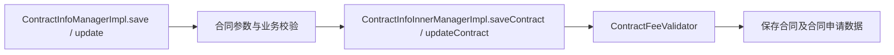
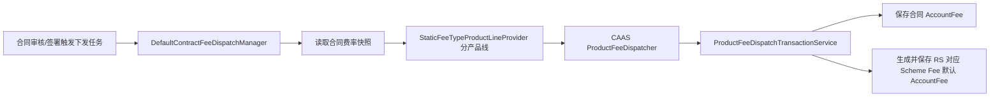

# PD-3703 合同与 AccountFee 开发说明

## 1. 文档目的

说明 QI/BZ RS 毛利返现从合同配置、校验、审核后费率下发，到 `account_fee` 写入默认 Scheme Fee 的实现链路和职责边界。

本需求只负责合同费率配置规则和账户费率默认数据落库，不调整 RS 毛利返现计算、Scheme Fee 金额计算、统计查询或交易费用 SQL。

## 2. 两条主要链路

### 2.1 合同创建与修改

- `ContractInfoManagerImpl.save` 是合同提交编排入口；`update` 是合同修改入口。
- `ContractInfoInnerManagerImpl.saveContract` 将合同基础信息、业务类型和费率申请内容写入合同及申请记录。
- `ContractInfoInnerManagerImpl.updateContract` 保存合同修改内容；修改和重启复用该入口。
- `ContractInfoManagerImpl.createContract` 主要生成合同 PDF，不是合同数据持久化入口。

RS/NR 互斥属于合同内容校验，因此在 `ContractInfoManagerImpl.save`、`update` 和 `restart` 的合同编排入口、写入合同数据前调用 `ContractFeeValidator`。校验本次请求费率清单，并读取同一账户 `account_fee` 中互斥类型的现存费率进行有效期比较；不依赖 `ApplyServiceImpl`，也不放在 `account_fee` 写入服务中。修改路径在 DocuSign envelope 作废前校验。

当前校验规则：

- QI RS 毛利返现与 QI 消费返现有效期重叠时拒绝。
- BZ RS 毛利返现与 BZ 消费返现有效期重叠时拒绝。
- QI 与 BZ 是不同渠道，可以同时配置。
- 有效期不重叠时允许配置；区间端点相接按重叠处理。
- 互斥校验中的费率起止时间为空时按无边界处理。生成默认 Scheme Fee 时，开始时间缺失取当前时间，结束时间缺失回退至本地时间 2099-02-01 23:59:59，与 Node 端一致。

### 2.2 审核完成后的合同费率下发

- `DefaultContractFeeDispatchManager` 读取已保存的合同费率快照，并按产品线分组下发。
- `StaticFeeTypeProductLineProvider` 将 QI/BZ RS 返现费率映射到 CAAS；没有该映射时，合同费率不会进入对应产品线下发器。
- `AbstractProductFeeDispatcher` 将下发请求交给 `ProductFeeDispatchTransactionService.saveAccountFees`。
- `saveAccountFees` 在独立事务中替换并保存合同费率；成功后继续保存对应的默认 Scheme Fee 费率。任一批次保存失败都会抛出异常，事务回滚。

合同审核和账户费率写入是不同阶段：合同创建阶段负责拒绝非法合同配置；审核后下发阶段负责将已批准费率同步到 `account_fee`。

## 3. RS 合同触发的默认 Scheme Fee

`ContractRsSchemeFeeDefaults` 按合同费率中的 RS 类型决定生成哪一组默认账户费率：

| 合同费率 | provider | 默认费率组 |
| --- | --- | --- |
| QI RS 毛利返现 | `QbitIssuing` | 32 条，包含普通费率类型和 `_Caas` 类型 |
| BZ RS 毛利返现 | `I2c` | 21 条，包含普通费率类型、`_Caas` 类型及 CAAS Scheme Signature Fee |
| 两种 RS 同时存在 | 分别按上述 provider 写入 | 53 条，QI/BZ 分组互不覆盖 |
| 没有 QI/BZ RS 配置 | 无 | 不额外生成默认费率 |

默认费率明细以 Node 项目 `account-business-fee-apply-handler.service.ts` 中的 `autoCreateSchemeDefaultFees`、`qiRateMap` 和 `bzRateMap` 为参考，在 Java 中显式列出，方便逐项核对。

生成记录沿用 Node 端字段规则：

- `accountId`：合同对应账户。
- `feeType`、`rate`、`mathType`、`low`、`high`：来自 QI/BZ 显式费率表。
- `type`：`Tiered`；单值费率使用从 0 开始且没有上界的区间。
- `childFeeType`：`MasterAccount`。
- `provider`：QI 为 `QbitIssuing`，BZ 为 `I2c`。
- `startTime` / `endTime`：沿用触发这组默认费率的 RS 合同费率有效期。

重复下发时，写入服务按账户、provider 和本次生成的 feeType 删除旧记录后批量写入。QI 与 BZ 分 provider 替换，避免同名费率跨渠道互相覆盖。

## 4. AccountFee 开发改动位置

| 文件 | 职责 |
| --- | --- |
| `ContractInfoManagerImpl.java` | 合同创建、修改和重启时调用 RS/NR 校验，并在 DocuSign 作废前完成修改校验 |
| `ContractFeeValidator.java` | 校验合同费率清单中的同渠道 RS/NR 有效期冲突 |
| `StaticFeeTypeProductLineProvider.java` | 将 QI/BZ RS 合同费率映射到 CAAS 下发产品线 |
| `ProductFeeDispatchTransactionService.java` | 在合同费率写入事务中保存 RS 触发的默认账户费率 |
| `ContractRsSchemeFeeDefaults.java` | 显式维护 QI/BZ 默认 Scheme Fee 费率条目并构造 `AccountFee` |

新增或调整费率类型时，需同时检查：

1. `AccountFeeType` 中是否已有对应类型。
2. 合同费率产品线映射是否包含该类型。
3. `ContractRsSchemeFeeDefaults` 中默认费率明细和 provider 是否正确。
4. 若类型参与互斥，更新 `ContractFeeValidator` 及其场景测试。
5. 默认配置数量、渠道隔离和有效期继承是否有测试覆盖。

## 5. 本需求范围与边界

- 调整合同费率校验和审核后的 `account_fee` 默认数据写入。
- 不改变 `cash_back_bonuses.scheme_fee` 查询或写入流程。
- 不改变 Scheme Fee 金额生成、RS 毛利返现计算、返现金额计算或交易费用 SQL。
- 不新增统计侧费率配置持久化；统计读取仍使用已有账户费率及统计链路。
- `ApplyServiceImpl` 不承担本次合同互斥校验，合同校验由合同持久化链路负责。

## 6. 本次新增测试

- `ContractFeeValidatorTest`：覆盖 QI/BZ 同渠道冲突、跨渠道允许和有效期不重叠允许。
- `ContractRsSchemeFeeDefaultsTest`：覆盖 QI/BZ 默认费率数量、provider、有效期继承和无 RS 时不生成。
- `ProductFeeDispatchTransactionServiceTest`：覆盖合同费率与 QI 默认费率在写入服务中的保存。
- `StaticFeeTypeProductLineProviderTest`：覆盖 QI/BZ RS 类型进入 CAAS 产品线。

遵照本轮“不要编译”的要求，没有在本轮对上述最终修改运行编译或测试；源码空白检查已执行。
