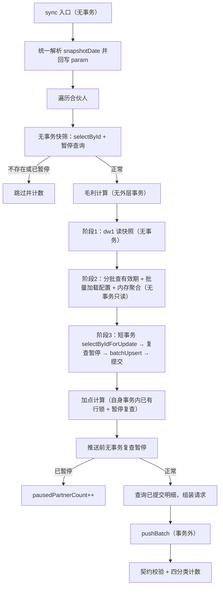
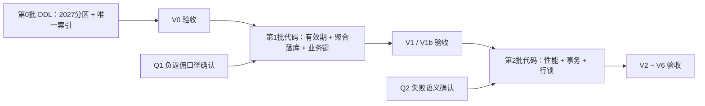

# 合伙人毛利返佣与月度同步改造方案（v2）

- **所属仓库**：`qbit-assets`（主模块 `qbit-core`）
- **基线**：`develop`（`147545ce47`），问题引入提交 `d458f01b45`（`#8033`）
- **关联问题**：`[P0-BIZ-3]`、`[P0-BIZ-4]`、`[P1-PERF-2]`、`[P0-BIZ-5]`，以及本次根据 DDL 新发现的分区缺失、字段口径冲突
- **v2 相对 v1 的主要变化**：
  1. 新增**第 0 批 DDL**：补 2027 分区（一个月内必炸）、加业务唯一索引；
  2. `stableId` 从“待确认”改为**本次修复**：`ON CONFLICT` 改为业务键，`id` 改用雪花 ID，历史数据完全兼容；
  3. 拆为**三批上线**，`P0-BIZ-3` 不再被大重构阻塞；
  4. 新增**负返佣口径待确认项**（DDL 注释与现行代码冲突）；
  5. 明确去掉外层事务后的**失败语义**；
  6. `snapshotDate` 改为**任务开始时统一解析一次**；
  7. 数据库实测从“核对清单”升级为**合入前必须通过的验收项**。

---

## 一、问题与批次总览

| 批次 | 内容 | 关联问题 | 紧急度 | 依赖 |
| --- | --- | --- | --- | --- |
| **第 0 批（DDL）** | 补建 2027 分区；新增业务唯一索引；补齐分区授权 | 新发现、`P0-BIZ-4` | **最高**（2027-01 跑 2026-12 结算前必须完成） | 无 |
| **第 1 批（代码，小改动）** | 有效期改为月区间交集；删除 `allocate()`，单组单条聚合落库；`ON CONFLICT` 改业务键 + `id` 改 `IdWorker.getId()` | `P0-BIZ-3`、`P0-BIZ-4` | **P0** | 唯一索引必须先于代码上线 |
| **第 2 批（代码，架构调整）** | 批量配置加载；分批 `.in`；`batchUpsert`；拆外层事务；`snapshotDate` 统一解析；行锁下沉短事务；推送移出事务 | `P1-PERF-2`、`P0-BIZ-5` | P0 / P1 | 第 1 批合入后 |

### 阻塞性待确认项（需在第 1 批合入前答复）

| 编号 | 问题 | 需谁确认 | 影响 |
| --- | --- | --- | --- |
| **Q1** | **负返佣口径**：负毛利时返佣是“生成负数用于抵扣”，还是“保底为 0”？ | 产品 + Partner 侧 | 决定 `commission_before_floor` / `commission_amount` 的写法及表注释 |
| **Q2** | **失败语义**：单个合伙人失败时，整个任务立即停止（现状），还是跳过继续处理后续合伙人？ | 架构 | 决定 `sync()` 循环的异常处理方式，见第 2 批 4.6 |
| **Q3** | 是否已有自动建分区机制（pg_partman / 定时任务）？ | DBA | 决定 2027 分区是一次性手工建还是纳入自动化 |

---

## 二、第 0 批：DDL 变更

### 2.1 补建 2027 分区（最紧急）

**问题**：`partner_gross_margin_commission_p` 按 `snapshot_date` 范围分区，当前仅有 `[2026-01-01, 2027-01-01)` 一个分区，且无 DEFAULT 分区。结算 `2026-12` 的任务在 2027 年 1 月执行，快照日期为 `2027-01-xx`，插入将报：

```text
ERROR: no partition of relation "partner_gross_margin_commission_p" found for row
```

**SQL**（授权以父表为准，补齐 2026 分区遗漏的 `"qbit-prod"`、`qbit_prod_read`）：

```sql
-- 1. 新建 2027 分区
CREATE TABLE public.partner_gross_margin_commission_2027
    PARTITION OF public.partner_gross_margin_commission_p
        FOR VALUES FROM ('2027-01-01') TO ('2028-01-01');

ALTER TABLE public.partner_gross_margin_commission_2027 OWNER TO qbit_admin;

GRANT SELECT ON public.partner_gross_margin_commission_2027 TO qbit_prod_read;
GRANT INSERT, REFERENCES, SELECT, TRIGGER, UPDATE ON public.partner_gross_margin_commission_2027 TO "qbit-prod";
GRANT SELECT ON public.partner_gross_margin_commission_2027 TO qbit_pay_prod;
GRANT INSERT, REFERENCES, SELECT, TRIGGER, UPDATE ON public.partner_gross_margin_commission_2027 TO qbit_prod_20250302;
GRANT SELECT ON public.partner_gross_margin_commission_2027 TO role_qbitpay_prod_core_ro;
GRANT INSERT, SELECT, UPDATE ON public.partner_gross_margin_commission_2027 TO role_qbitpay_prod_core_rw;

-- 2. 补齐 2026 分区遗漏的授权（应用经父表访问不受影响，仅影响直接查分区的账号）
GRANT SELECT ON public.partner_gross_margin_commission_2026 TO qbit_prod_read;
GRANT INSERT, REFERENCES, SELECT, TRIGGER, UPDATE ON public.partner_gross_margin_commission_2026 TO "qbit-prod";
```

> [!IMPORTANT]
> 若 Q3 确认没有自动建分区机制，需在运维日历中登记“每年 12 月前建次年分区”，或评估引入 pg_partman。

### 2.2 新增业务唯一索引

**问题**：当前仅有主键 `(id, snapshot_date)` 与普通索引 `idx_partner_gross_margin_commission_query`，无业务唯一约束。32-bit `stableId` 一旦跨客户碰撞，`ON CONFLICT (id, snapshot_date) DO UPDATE` 会**静默覆盖**另一个客户的记录。

**上线前数据校验**（老逻辑下同一业务五元组恒生成同一 `id`，理论上不会有重复，执行确认）：

```sql
SELECT settlement_month, partner_id, account_id, product_line_type, snapshot_date, COUNT(*)
FROM public.partner_gross_margin_commission_p
GROUP BY settlement_month, partner_id, account_id, product_line_type, snapshot_date
HAVING COUNT(*) > 1;
-- 预期：0 行
```

**建索引 SQL**：

```sql
-- 分区表唯一索引必须包含分区键 snapshot_date；在父表创建会自动级联到所有分区（含新建的 2027）
CREATE UNIQUE INDEX uk_partner_gross_margin_commission_biz
    ON public.partner_gross_margin_commission_p
    (settlement_month, partner_id, account_id, product_line_type, snapshot_date);
```

> [!WARNING]
> 分区表父表**不支持** `CREATE INDEX CONCURRENTLY`，建索引期间会短暂锁表。该表为月度快照数据量小，选非跑批时段执行即可。

**索引说明**：
- 新唯一索引前四列与 `idx_partner_gross_margin_commission_query` 完全一致，可覆盖 `selectCommissionRows` 的查询；稳定运行一段时间后可评估删除旧普通索引（非本次范围）。

### 2.3 回滚 SQL

```sql
-- 注意顺序：必须先回滚第 1 批代码（ON CONFLICT 依赖该索引），再删除索引
DROP INDEX IF EXISTS public.uk_partner_gross_margin_commission_biz;
-- 2027 分区为纯新增，无需回滚
```

---

## 三、第 1 批：业务正确性修复（小改动，尽快合入）

> [!IMPORTANT]
> **上线顺序**：第 0 批唯一索引 → 第 1 批代码。若代码先上，`ON CONFLICT (业务键)` 会报 `there is no unique or exclusion constraint matching the ON CONFLICT specification`。

### 3.1 `[P0-BIZ-3]` 有效期改为上海时区月区间交集

- **文件**：`PartnerGrossMarginCommissionServiceImpl.java`
- **根因**：初始化（`PartnerMerchantServiceImpl`）与后台编辑（`CustomerCommissionModeService`）均将 `expiration_time` 规范化为上海时区月末 `23:59:59.999 +08:00`。测试环境实测：前端传 `"2027-12-31T23:59:59+08:00"`，库内存 `2027-12-31 15:59:59.999000 +00:00`。现行代码截断为 `YearMonth` 后用 `settlementMonth.isBefore(expirationMonth)`，到期当月整月被判失效。
- **实现**：

```java
/**
 * 判断结算月是否处于客户毛利分佣有效期内。
 *
 * <p>按 Asia/Shanghai 结算月区间 [monthStart, nextMonthStart) 与有效期 [effectiveTime, expirationTime]
 * 求交集，同时兼容“月末 23:59:59.999”与“次月 1 日 00:00:00”两种落库格式。</p>
 *
 * @param settlementMonth 结算月份
 * @param mode            客户毛利分佣模式及其有效期
 * @return 结算月份是否处于有效期内
 */
private boolean isWithinEffectiveMonth(YearMonth settlementMonth, PartnerCommissionMode mode) {
    if (mode.getEffectiveTime() == null || mode.getExpirationTime() == null) {
        return false;
    }
    Instant effectiveInstant = mode.getEffectiveTime().toInstant();
    Instant expirationInstant = mode.getExpirationTime().toInstant();
    if (effectiveInstant.isAfter(expirationInstant)) {
        return false;
    }
    Instant monthStart = settlementMonth.atDay(1).atStartOfDay(BUSINESS_ZONE).toInstant();
    Instant nextMonthStart = settlementMonth.plusMonths(1).atDay(1).atStartOfDay(BUSINESS_ZONE).toInstant();
    return effectiveInstant.isBefore(nextMonthStart) && expirationInstant.isAfter(monthStart);
}
```

- **边界对照**：

| 库内失效时间（UTC） | 上海时区 | 结算 `2027-12` | 结算 `2028-01` |
| --- | --- | --- | --- |
| `2027-12-31 15:59:59.999` | `2027-12-31 23:59:59.999` | 现网 `false` → **修复后 `true`** | `false` |
| `2027-12-31 16:00:00.000` | `2028-01-01 00:00:00.000` | `true` | `false`（不会多发） |

### 3.2 `[P0-BIZ-4]` 删除 `allocate()`，单组单条聚合落库

- **文件**：`PartnerGrossMarginCommissionServiceImpl.java`
- **背景**：`d458f01b45` 将分组键由 `(partnerId, productLineType)` 细化为 `(partnerId, accountId, productLineType)`。按 DW SQL 结构，正常数据下每组仅 1 行，`allocate()` 与 `for (row : rows)` 已成为“拆了又合”的历史残留；但若 DW 粒度细化或 ETL 重复，循环 `upsert` 会让后一行覆盖前一行，造成毛利与返佣错账。
- **改动**：
  1. 删除 `allocate(List<PartnerGrossMarginProfitRow>, BigDecimal)`；
  2. 每组汇总 `grossProfit` 后只构建 **1 条**记录：

     | 字段 | 取值 |
     | --- | --- |
     | `grossProfit` | `defaultValue(组内毛利汇总)` |
     | `commissionBeforeFloor` | `defaultValue(commission)` |
     | `commissionAmount` | **待 Q1 确认**，见 3.4 |
     | `configId` | `config.getId()` |

  3. 统计口径：保存成功 `success += 1`，缺配置跳过 `skipped += 1`（按分组计，不再按快照行数）。

### 3.3 `[P0-BIZ-4]` `ON CONFLICT` 改业务键，`id` 改雪花 ID

- **文件**：`PartnerGrossMarginCommissionMapper.java`、`PartnerGrossMarginCommissionServiceImpl.java`
- **改动**：
  1. `upsert` 的冲突目标由 `(id, snapshot_date)` 改为业务唯一键：

     ```sql
     ON CONFLICT (settlement_month, partner_id, account_id, product_line_type, snapshot_date) DO UPDATE SET
         gross_profit = EXCLUDED.gross_profit,
         commission_before_floor = EXCLUDED.commission_before_floor,
         commission_amount = EXCLUDED.commission_amount,
         config_id = EXCLUDED.config_id,
         config_effective_time = NULL,
         config_expiration_time = NULL,
         version = partner_gross_margin_commission_p.version + 1,
         remarks = EXCLUDED.remarks,
         update_time = EXCLUDED.update_time
     ```

     （业务键字段本身无需再在 `SET` 中更新。）
  2. 删除 `stableId(...)`，`record.setId(IdWorker.getId())`（`d458f01b45` 之前即使用 `IdWorker`）。
- **为什么历史数据完全兼容**：重跑老快照时按业务键命中，`DO UPDATE` 不修改 `id`，老记录 `id` 原样保留，不会产生重复行；新记录用雪花 ID，即便极端情况下主键冲突也会**显式报错**，不再静默覆盖。

### 3.4 负返佣口径（依赖 Q1）

**冲突点**：

| 来源 | `commission_before_floor` | `commission_amount` |
| --- | --- | --- |
| DDL 注释 | 负毛利时为 0 | `MAX(commission_before_floor, 0)` |
| 现行代码（`d458f01b45` 起） | 负数（第一阶梯费率 × 负毛利） | 负数（同左） |
| 字段命名推断 | 保底前原始值（可为负） | 保底后值 |

**两种落地选项**（代码层只需改一处赋值）：

| 选项 | `commissionBeforeFloor` | `commissionAmount` | 需同步 |
| --- | --- | --- | --- |
| **A：负数抵扣**（保持现行行为） | `commission` | `commission` | 更新 DDL 注释 |
| **B：保底为 0** | `commission` | `commission.max(ZERO)` | Partner 侧确认不再收到负数 |

> [!CAUTION]
> Q1 确认前，第 1 批**保持现行行为（选项 A）**，避免单方面改变结算金额；确认后按结论调整赋值，并执行注释更新：
>
> ```sql
> -- 选项 A 示例
> COMMENT ON COLUMN public.partner_gross_margin_commission_p.commission_before_floor IS '按阶梯计算的原始返佣金额；负毛利按第一阶梯费率生成负返佣';
> COMMENT ON COLUMN public.partner_gross_margin_commission_p.commission_amount IS '最终返佣金额；负毛利时为负数，用于抵扣';
> ```

### 3.5 第 1 批文件清单

| 操作 | 文件 |
| --- | --- |
| 修改 | `qbit-core/src/main/java/com/qbit/common_all/partner/grossmargin/service/impl/PartnerGrossMarginCommissionServiceImpl.java` |
| 修改 | `qbit-core/src/main/java/com/qbit/common_all/partner/grossmargin/mapper/PartnerGrossMarginCommissionMapper.java` |
| 新增 | `qbit-core/src/test/java/com/qbit/common_all/partner/grossmargin/service/impl/PartnerGrossMarginCommissionServiceImplTest.java` |

---

## 四、第 2 批：性能与事务架构调整

### 4.1 目标约束

1. **No HTTP In Transaction**：`pushClient.pushBatch` 不在任何数据库事务内；
2. **不占双连接池**：读取 `dw1` 时不持有 `db1` 事务连接；
3. **暂停提现强互斥**：与 `PartnerMerchantServiceImpl.pauseWithdrawal` 按合伙人账户行串行化；
4. **无 N+1、无超长 IN**。

### 4.2 整体编排



### 4.3 批量配置加载，消除 N+1

**现状**：每组调 `configService.queryEffectiveConfig`，每次 4 条 SQL（主表、梯度表、账户展示名、模式表），后两条与计算无关。2,000 户 × 2 产品线 = 16,000+ SQL。

**改动**：
- **新增** `PartnerGrossMarginConfigKey`（record：`partnerId`、`accountId`、`productLineType`）；
- **新增** `PartnerGrossMarginConfigLoader`（`@Component`，不为单实现抽接口；`PartnerGrossMarginConfigServiceImpl` 已 481 行，不再往里加）：
  1. 按 `partnerId` 归组，`accountIds` 每 500 个一批查 `partner_gross_margin_config`，按 `create_time DESC, id DESC` 排序后 `putIfAbsent` 取最新；
  2. 命中的 `configId` 每 500 个一批查 `partner_gross_margin_config_detail`；
  3. 只组装 `id`、业务键与 `detailVOList`，**不查 `account` 表与 `partner_commission_mode` 表**。
- **保持不变**：`PartnerGrossMarginConfigService.queryEffectiveConfig`（`PartnerCommissionFeign.getGrossProfitConfigDetail` 仍在用）。
- **收益**：16,000+ SQL → 约 12 条。

### 4.4 分批 `.in` 与 `batchUpsert`

1. `queryEligibleGrossMarginCustomerIds`：`customerIds` 每 500 个一批查询并合并，消除 PostgreSQL 32,767 绑定参数上限风险。
2. `PartnerGrossMarginCommissionMapper` 新增 `batchUpsert`（新建 `mapper/partner/PartnerGrossMarginCommissionMapper.xml`）：
   - `<foreach>` 批量 `VALUES`，冲突目标同 3.3 的业务键；
   - 每批 500 条（14 参数/条，单批 7,000 参数）；
   - 由于每组业务键唯一且一组一条，同批内不会出现重复业务键，**无需 v1 中的冲突键切批逻辑**。
   - **必要性**：第 3 阶段需持有合伙人账户行锁，逐条 upsert 4,000 次会显著拉长持锁时间。

### 4.5 `snapshotDate` 统一解析

**现状**：`snapshotDate` 为空时，每个合伙人各自执行 `MAX(snapshot_date)` 子查询；若跑批途中 DW 刷新出新快照，前后合伙人口径不一致。v1 方案“锁定第一个合伙人返回值”逻辑隐晦，且首个合伙人无数据时会后移。

**改动**：
- `PartnerGrossMarginProfitMapper` 新增 `@DS("dw1") LocalDate selectLatestSnapshotDate(LocalDate settlementMonth)`：

  ```sql
  SELECT MAX(snapshot_date)
  FROM dws.dws_partner_account_profit_snapshot_p
  WHERE product IN ('qbit_card', 'crypto', 'group_account')
    AND settlement_month = #{settlementMonth}
  ```

- `PartnerGrossMarginSnapshotReader` 新增 `resolveLatestSnapshotDate(...)`；
- `PartnerMonthlyCommissionSyncServiceImpl.sync()` 入口若 `param.snapshotDate` 为空，解析一次并**回写 `param`**，使毛利计算与推送查询（`buildPushRequest` 中的 `query.setSnapshotDate`）使用同一快照；
- `PartnerGrossMarginCommissionServiceImpl.calculate()` 被独立任务 `PartnerGrossMarginCommissionJob` 调用时同样先解析一次；DW 无快照则直接返回空结果。

### 4.6 事务边界与暂停互斥锁

#### `PartnerGrossMarginSnapshotReader`
- 保留 `@DS("dw1")`，移除 `@Transactional(propagation = NOT_SUPPORTED)`；
- 入口增加守卫，防止后人再包外层事务导致 `@DS` 切换失效或双连接池占用：

  ```java
  if (TransactionSynchronizationManager.isActualTransactionActive()) {
      throw new IllegalStateException("禁止在活跃数据库事务内读取 DW 毛利快照，partnerAccountId="
              + partnerAccountId + ", settlementMonth=" + settlementMonth);
  }
  ```

> [!WARNING]
> `d458f01b45` 曾修复“事务问题没有查到快照表”，`NOT_SUPPORTED` 很可能正是为让 `@DS("dw1")` 在外层事务下生效而加。移除后**必须在测试环境实测**无事务下能正确切到数仓（见第五章验收项 V2）。

#### `PartnerGrossMarginCommissionServiceImpl`
- 移除 `calculate()` 的 `@Transactional`；
- 注入 `PartnerGrossMarginConfigLoader`（替换 `PartnerGrossMarginConfigService`）、`AccountMapper`、`PartnerWithdrawalPauseMapper`、`TransactionTemplate`；
- 逐合伙人三阶段执行，第 3 阶段短事务：

  ```java
  Boolean persisted = transactionTemplate.execute(status -> {
      Account partnerAccount = accountMapper.selectByIdForUpdate(partnerAccountId);
      if (partnerAccount == null) {
          log.warn("合伙人账户不存在，放弃毛利返佣落库，partnerAccountId={}", partnerAccountId);
          return Boolean.FALSE;
      }
      if (withdrawalPauseMapper.selectByAccountId(partnerAccountId) != null) {
          log.warn("合伙人佣金生成已暂停，放弃毛利返佣落库，reasonCode=WITHDRAWAL_PAUSED，partnerAccountId={}",
                  partnerAccountId);
          return Boolean.FALSE;
      }
      batchUpsertRecords(records);
      return Boolean.TRUE;
  });
  ```

  行锁只在内存计算完成、批量写入的最后阶段持有，提交即释放。

#### `PartnerMonthlyCommissionSyncServiceImpl`
- 移除 `sync()` 的 `@Transactional`；
- 入口无事务快筛（`selectById` + 暂停查询）；
- 推送前再做一次无事务暂停复查（远程仍有 `RESULT_SKIPPED_PAUSED` 兜底）；
- `pushClient.pushBatch` 在事务外执行。

#### 失败语义（依赖 Q2）

去掉外层事务后，语义由“全部回滚”变为“已处理的合伙人已提交”：

| 选项 | 行为 | 优点 | 缺点 |
| --- | --- | --- | --- |
| **A：遇错即停（推荐，本次采用）** | 第 k 个失败即抛出，任务失败；前 k-1 个本地与远程均已一致提交 | 契约不匹配等严重错误立即暴露；改动最小 | k 之后的合伙人需重跑才处理 |
| B：单合伙人隔离 | 捕获单合伙人异常、记录并继续，结果中增加失败数 | 单点故障不影响其他合伙人 | 需区分可继续/必须停止的异常；需扩展结果 DTO |

**选项 A 的重跑闭环**：本地 upsert 按业务键幂等；加点分佣由 `is_commission` 标记防重复；远程按 `sourceBatchNo` 返回 `RESULT_DUPLICATE`。复用同一 `sourceBatchNo` 重跑即可补齐。

### 4.7 第 2 批文件清单

| 操作 | 文件 |
| --- | --- |
| 新增 | `.../grossmargin/domain/bo/PartnerGrossMarginConfigKey.java` |
| 新增 | `.../grossmargin/service/PartnerGrossMarginConfigLoader.java` |
| 新增 | `qbit-core/src/main/resources/mapper/partner/PartnerGrossMarginCommissionMapper.xml` |
| 修改 | `.../grossmargin/mapper/PartnerGrossMarginCommissionMapper.java`（新增 `batchUpsert`） |
| 修改 | `.../grossmargin/mapper/PartnerGrossMarginProfitMapper.java` + `PartnerGrossMarginProfitMapper.xml`（新增 `selectLatestSnapshotDate`） |
| 修改 | `.../grossmargin/service/PartnerGrossMarginSnapshotReader.java` |
| 修改 | `.../grossmargin/service/impl/PartnerGrossMarginCommissionServiceImpl.java` |
| 修改 | `.../commission/service/impl/PartnerMonthlyCommissionSyncServiceImpl.java` |
| 新增 | `.../grossmargin/service/PartnerGrossMarginConfigLoaderTest.java` |
| 修改 | `.../grossmargin/service/impl/PartnerGrossMarginCommissionServiceImplTest.java` |
| 修改 | `.../commission/PartnerMonthlyCommissionPauseGuardTest.java` |

**明确不改**：`PartnerGrossMarginConfigService(Impl)`、`PartnerCommissionFeign`、`PartnerGrossMarginCalculator`、`PartnerCommissionFeeTransactionService`。

---

## 五、测试与验收

### 5.1 单元测试（编排与计算逻辑）

| 测试类 | 批次 | 验证点 |
| --- | --- | --- |
| `PartnerGrossMarginCommissionServiceImplTest` | 1 | 有效期边界（月末 `.999`、次月 00:00、生效前、倒挂）；同组多行只生成 1 条聚合记录且 `successCount = 1`；负毛利生成负返佣（选项 A）；`id` 非 `null` 且不再依赖哈希 |
| `PartnerGrossMarginConfigLoaderTest` | 2 | 空入参零查询；620 客户主表、梯度表各 2 批；同键多版本取最新；不触碰账户表与模式表 |
| `PartnerGrossMarginCommissionServiceImplTest` | 2 | `calculate()` / `readSnapshotRows()` 无 `@Transactional`；活跃事务内读 DW 抛异常；1,050 客户有效期查询分 3 批；配置加载仅 1 次；`batchUpsert` 单批 ≤ 500；短事务内先行锁后复查暂停，已暂停不写入 |
| `PartnerMonthlyCommissionPauseGuardTest` | 2 | `sync()` 无 `@Transactional`；原 12 个用例适配后全部通过；推送前并发暂停被拦截；`snapshotDate` 为空时统一解析并回写 |
| `PartnerGrossMarginConfigModeWindowTest`（已有） | 2 | 回归：`queryEffectiveConfig` 行为不变 |

```bash
mvn -pl qbit-core -am test -DskipTests=false -DfailIfNoTests=false \
  -Dtest=PartnerGrossMarginCommissionServiceImplTest,PartnerGrossMarginConfigLoaderTest,PartnerGrossMarginConfigModeWindowTest,PartnerMonthlyCommissionPauseGuardTest
git diff --stat
git diff --check
```

### 5.2 数据库实测（合入前必须通过）

> [!IMPORTANT]
> 单元测试中 `TransactionTemplate` 与 Mapper 均为 Mock，**无法证明** SQL、事务、行锁、数据源切换的真实行为。按 `AGENTS.md` “SQL、事务、锁不用 Mock 冒充”，以下各项须在测试环境验证并留存证据。

| 编号 | 批次 | 验收项 | 通过标准 |
| --- | --- | --- | --- |
| V0 | 0 | 2027 分区与唯一索引 | 插入 `snapshot_date = 2027-01-05` 测试行成功；重复业务键插入报唯一冲突 |
| V1 | 1 | 有效期修复 | 选一个 `expiration_time = 当月末 15:59:59.999 UTC` 的客户跑结算，返佣不再为 0 |
| V1b | 1 | 业务键 upsert | 同一快照重跑两次：行数不变、`version` +1、老记录 `id` 不变 |
| V2 | 2 | `@DS("dw1")` 无事务切换 | 去掉 `NOT_SUPPORTED` 后能正确读到数仓快照（复现 `d458f01b45` 当初场景） |
| V3 | 2 | `batchUpsert` | 真实 PostgreSQL 执行成功，冲突更新字段正确 |
| V4 | 2 | 暂停互斥 | 一个会话持有合伙人行锁（模拟 `pauseWithdrawal`）时，毛利落库阻塞等待；暂停提交后落库被放弃 |
| V5 | 2 | 连接与 SQL | 跑批期间 `pg_stat_activity` 无 `db1` 的 `idle in transaction` 长事务；慢 SQL 日志无 N+1 配置查询 |
| V6 | 2 | 重跑幂等 | 复用同一 `sourceBatchNo` 重跑：本地无重复，远程返回 `RESULT_DUPLICATE` |

---

## 六、协作与沟通事项

1. **PD-2638 作者（huangmingbo）**：`selectByIdForUpdate` 互斥设计与 `PartnerMonthlyCommissionPauseGuardTest` 来自 PD-2638。第 2 批将锁从 `sync()` 下沉到毛利写事务，语义等价但断言重构，需提前同步。
2. **产品 / Partner 侧**：答复 Q1 负返佣口径；确认 `interlace_partner_service` 的 `pushBatch` 按 `sourceBatchNo` 幂等、暂停合伙人返回 `RESULT_SKIPPED_PAUSED`。
3. **DBA**：执行第 0 批 DDL；答复 Q3 自动建分区机制。
4. **附加观察（非本次范围）**：`selectCommissionRows` 中 `LATERAL` 阶梯匹配条件为 `s.gross_profit >= d.ladder_min_amount`，负毛利且第一阶梯下限为 0 时 `commission_share_rate` 为 `null`（`commission_amount` 本身正确）。若 Q1 确认负数抵扣且下游需要展示费率，再单独调整。

---

## 七、上线顺序



| 截止时间 | 事项 |
| --- | --- |
| **2026-12 内** | 第 0 批 DDL 完成（2027-01 执行 2026-12 结算前） |
| 第 0 批后 | 第 1 批合入（Q1 未答复则先按选项 A 保持现行行为） |
| 第 1 批稳定后 | 第 2 批合入 |
