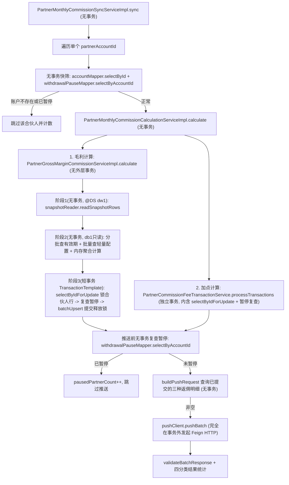

# 合伙人毛利返佣与月度同步改造开发方案

- **所属仓库**：`qbit-assets`（主模块 `qbit-core`）
- **基线分支 / 提交**：`develop`（`147545ce47`）
- **关联问题**：`[P0-BIZ-3]`、`[P0-BIZ-4]`、`[P1-PERF-2]`、`[P0-BIZ-5]`
- **方案目标**：在不破坏现有对外 Feign 契约（`PartnerCommissionFeign` / `PartnerCommissionPushClient`）和后台配置分页/详情逻辑的前提下，一次性闭环解决毛利有效期少发 1 个月、N+1 SQL 雪崩、超长 `.in(...)` 崩溃、双连接池占用、大事务内同步 Feign HTTP 及暂停提现互斥锁失效问题。

---

## 一、改造范围与边界决策

### 1. 本次直接改造范围（无 DDL 依赖，可立即落地）

| 模块 | 问题编号 | 核心改造动作 |
| --- | --- | --- |
| 毛利有效期判定 | `P0-BIZ-3` | `isWithinEffectiveMonth` 由 `YearMonth` 半开区间改为上海时区结算月 `[monthStart, nextMonthStart)` 与 `[effectiveTime, expirationTime]` 求交集 |
| 客户维度聚合落库 | `P0-BIZ-4`（部分） | 删除历史残留的 `allocate()` 及同组 `for (row : rows)` 循环写入，每个 `(partnerId, accountId, productLineType)` 聚合为 1 条记录落库，按分组数统计 `successCount` |
| 批量配置加载与分批查询 | `P1-PERF-2` | 新增轻量批量配置加载器 `PartnerGrossMarginConfigLoader`（500/批，不查账户展示名与模式表）；`queryEligibleGrossMarginCustomerIds` 改为 500/批 `.in(...)`；新增 `batchUpsert`（500 条/批） |
| 事务边界与双连接池解耦 | `P1-PERF-2` | 移除 `PartnerMonthlyCommissionSyncServiceImpl.sync()` 与 `PartnerGrossMarginCommissionServiceImpl.calculate()` 的外层 `@Transactional`；`PartnerGrossMarginSnapshotReader` 移除 `NOT_SUPPORTED` 并增加活跃事务快速失败校验；`pushClient.pushBatch` 完全在事务外执行 |
| 暂停提现互斥锁恢复 | `P0-BIZ-5` | 将 `accountMapper.selectByIdForUpdate` + `withdrawalPauseMapper.selectByAccountId` 下沉至单合伙人毛利落库短事务内；`sync()` 外层仅做无事务快筛与推送前复查；修复并重构单测 |

### 2. 待确认后再改造项（先不盲改，避免误伤线上历史数据）

1. **`stableId` 算法升级（`P0-BIZ-4` 剩余部分）**：
   - **风险**：当前 `Math.abs(Objects.hash(...))` 存在 32-bit 哈希碰撞及 `Integer.MIN_VALUE` 负数风险；但若 `partner_gross_margin_commission_p` 分区表当前没有 `(snapshot_date, settlement_month, partner_id, account_id, product_line_type)` 业务唯一索引，直接更换 `id` 算法会导致重跑历史 `snapshot_date` 时插出重复行。
   - **前置确认**：检查生产/测试库 `partner_gross_margin_commission_p` DDL：
     - **方案 A（最优）**：存在或补充业务唯一索引，将 `ON CONFLICT` 改为按业务唯一键冲突更新，`id` 切换为 64-bit 确定性哈希（SHA-256 取 63 位正 `long`）或雪花 ID；
     - **方案 B（无 DDL 变更）**：仅切 64-bit 确定性哈希，并明确规定不对已有老 `snapshot_date` 直接覆盖重跑（或重跑前先软删/清理旧 `snapshot_date` 数据）。
2. **负毛利对外查询 `commissionShareRate` 展示（附加观察项）**：
   - `PartnerGrossMarginProfitMapper.xml` 的 `selectCommissionRows` 中 `LATERAL` 子查询条件为 `s.gross_profit >= d.ladder_min_amount`，当毛利 `< 0` 且第一阶梯下限为 `0` 时，`commission_share_rate` 返回 `null`（`commission_amount` 仍为正确负返佣）。需与产品/Partner 侧确认负毛利是否需要兜底展示第一阶梯费率。

---

## 二、详细技术设计

### 改造 1：`[P0-BIZ-3]` 毛利有效期改为上海时区月区间交集

- **修改文件**：`qbit-core/src/main/java/com/qbit/common_all/partner/grossmargin/service/impl/PartnerGrossMarginCommissionServiceImpl.java`
- **现状问题**：初始化（`PartnerMerchantServiceImpl`）和后台修改（`CustomerCommissionModeService`）均将 `expiration_time` 存为上海时区月末 `23:59:59.999 +08:00`（PG UTC 显示 `15:59:59.999000 +00:00`），而 `isWithinEffectiveMonth` 截断为 `YearMonth` 后使用 `settlementMonth.isBefore(expirationMonth)`，导致到期当月整月被判失效。
- **改造实现**：
  ```java
  /**
   * 按 Asia/Shanghai 结算月区间 [monthStart, nextMonthStart) 与客户模式有效期 [effectiveTime, expirationTime]
   * 是否存在交集判断有效性；兼容月末 23:59:59.999 与次月 1 日 00:00:00 两种落库格式。
   *
   * @param settlementMonth 结算月份
   * @param mode            客户毛利分佣模式及其有效期
   * @return 结算月份是否处于客户毛利分佣有效范围内
   */
  private boolean isWithinEffectiveMonth(YearMonth settlementMonth, PartnerCommissionMode mode) {
      if (mode.getEffectiveTime() == null || mode.getExpirationTime() == null) {
          return false;
      }
      Instant effectiveInstant = mode.getEffectiveTime().toInstant();
      Instant expirationInstant = mode.getExpirationTime().toInstant();
      if (effectiveInstant.isAfter(expirationInstant)) {
          return false;
      }
      Instant monthStart = settlementMonth.atDay(1).atStartOfDay(BUSINESS_ZONE).toInstant();
      Instant nextMonthStart = settlementMonth.plusMonths(1).atDay(1).atStartOfDay(BUSINESS_ZONE).toInstant();
      return effectiveInstant.isBefore(nextMonthStart) && expirationInstant.isAfter(monthStart);
  }
  ```
- **验证边界**：
  - `2027-12-31 15:59:59.999 +00:00`（即上海 `2027-12-31 23:59:59.999 +08:00`）：`2027-12` → `true`，`2028-01` → `false`；
  - `2028-01-01 00:00:00.000 +08:00`（次月 1 日 00:00 历史格式）：`2027-12` → `true`，`2028-01` → `false`；
  - 生效时间晚于结算月月底（如 `2028-01-01 00:00:00 +08:00` 结算 `2027-12`）→ `false`；
  - 起止时间倒挂 → `false`。

---

### 改造 2：`[P0-BIZ-4]` 删除 `allocate()`，按 `(partnerId, accountId, productLineType)` 聚合单条落库

- **修改文件**：`qbit-core/src/main/java/com/qbit/common_all/partner/grossmargin/service/impl/PartnerGrossMarginCommissionServiceImpl.java`
- **改造动作**：
  1. 删除私有方法 `allocate(List<PartnerGrossMarginProfitRow> rows, BigDecimal commission)`；
  2. 每个 `PartnerGrossMarginConfigKey(partnerId, accountId, productLineType)` 分组汇总所有快照行的 `grossProfit` 得到 `customerProductLineGrossProfit`；
  3. 有效期内通过 `PartnerGrossMarginCalculator.calculate(customerProductLineGrossProfit, tiers)` 计算返佣（正毛利按超额累进，负毛利按第一阶梯费率计算负返佣）；有效期外返佣为 `ZERO`；
  4. 每个分组仅构建 **1 条** `PartnerGrossMarginCommission` 聚合记录：
     - `grossProfit = defaultValue(customerProductLineGrossProfit)`
     - `commissionBeforeFloor = defaultValue(commission)`
     - `commissionAmount = defaultValue(commission)`
     - `configId = config.getId()`
  5. 统计口径：保存成功时 `success += 1`（按聚合落库分组数统计）；缺少配置跳过时 `skipped += 1`。

---

### 改造 3：`[P1-PERF-2]` 消除 N+1、分批 `.in(...)`、批量 Upsert 与事务/连接池解耦

#### 3.1 新增轻量配置键对象与批量加载器（消除 16,000+ N+1 SQL）

遵循 `AGENTS.md` 规范：
- `PartnerGrossMarginConfigServiceImpl` 已有 481 行，继续往里塞批量逻辑会超 500 行上限；
- 不为单实现协作者额外定义接口，新增独立 `@Component` 协作者 `PartnerGrossMarginConfigLoader`；
- 原有 `PartnerGrossMarginConfigService.queryEffectiveConfig(...)` **保持完全不动**，确保 `PartnerCommissionFeign.getGrossProfitConfigDetail` 与 `PartnerGrossMarginConfigModeWindowTest` 零影响。

1. **新增文件**：`qbit-core/src/main/java/com/qbit/common_all/partner/grossmargin/domain/bo/PartnerGrossMarginConfigKey.java`
   ```java
   package com.qbit.common_all.partner.grossmargin.domain.bo;

   /**
    * 合伙人毛利率配置匹配键（合伙人、客户与产品线）。
    *
    * @param partnerId       合伙人账户 ID
    * @param accountId       客户账户 ID
    * @param productLineType 产品线类型
    * @author martinjiang
    */
   public record PartnerGrossMarginConfigKey(String partnerId, String accountId, String productLineType) {
   }
   ```
2. **新增文件**：`qbit-core/src/main/java/com/qbit/common_all/partner/grossmargin/service/PartnerGrossMarginConfigLoader.java`
   - 依赖：`PartnerGrossMarginConfigMapper`、`PartnerGrossMarginConfigDetailMapper`（`@RequiredArgsConstructor` + `private final`）；
   - 核心方法：`Map<PartnerGrossMarginConfigKey, GrossMarginConfigVO> loadEffectiveConfigs(Collection<PartnerGrossMarginConfigKey> keys)`；
   - 查询策略（`IN_QUERY_BATCH_SIZE = 500`）：
     1. 将 `keys` 按 `partnerId` 归组，提取每个 `partnerId` 下的去重 `accountIds` 和 `productLineTypes`；
     2. 对每个 `partnerId` 的 `accountIds` 按 500 分批查询 `partner_gross_margin_config`（`eq(partnerId).in(accountBatch).in(productLines).orderByDesc(createTime, id)`），遍历结果按 `latestConfigs.putIfAbsent(key, config)` 仅保留最新 1 条；
     3. 提取命中的去重 `configIds`，按 500 分批查询 `partner_gross_margin_config_detail`（`in(configIdBatch).orderByAsc(ladderMinAmount)`）；
     4. 组装轻量 `GrossMarginConfigVO`（只填充 `id`、`partnerId`、`accountId`、`productLineType`、`detailVOList`），**彻底跳过 `AccountMapper` 与 `PartnerCommissionModeMapper`**。
   - **SQL 数量对比（2,000 户 × 2 产品线）**：从 **16,000+ 条** 降至 **~12 条**（4 条主表 + 8 条梯度表）。

#### 3.2 `queryEligibleGrossMarginCustomerIds` 改为 500/批 `.in(...)`

- **修改文件**：`PartnerGrossMarginCommissionServiceImpl.java`
- **实现要点**：
  - 将去重后的 `customerIds` 按 `IN_QUERY_BATCH_SIZE = 500` 切分；
  - 逐批执行 `partnerCommissionModeMapper.selectList(...)` 并使用改造后的 `isWithinEffectiveMonth` 过滤，合并至 `Set<String> eligibleIds`；
  - 彻底消除 PostgreSQL 32,767 参数上限风险。

#### 3.3 新增 `batchUpsert`（缩短写事务耗时）

- **修改文件**：`qbit-core/src/main/java/com/qbit/common_all/partner/grossmargin/mapper/PartnerGrossMarginCommissionMapper.java`
- **新增文件**：`qbit-core/src/main/resources/mapper/partner/PartnerGrossMarginCommissionMapper.xml`
- **实现要点**：
  - 保留原有单条 `upsert(PartnerGrossMarginCommission record)` 兼容；
  - 新增 `int batchUpsert(@Param("records") List<PartnerGrossMarginCommission> records)`，使用 `<foreach>` 生成 PostgreSQL 批量 `INSERT ... VALUES (...), (...) ON CONFLICT (id, snapshot_date) DO UPDATE SET ...`；
  - 每条记录 14 个参数，按 `UPSERT_BATCH_SIZE = 500` 分批写入（单批最多 7,000 参数，远低于 32,767）；
  - 写入分批时维护批内 `Set<String> seenConflictKeys`（`id + ":" + snapshotDate`），一旦遇到极小概率哈希冲突导致的重复 `(id, snapshotDate)` 立即先 flush 当前批再开新批，避免 PostgreSQL 报 `ON CONFLICT DO UPDATE command cannot affect row a second time`。

#### 3.4 `PartnerGrossMarginSnapshotReader` 移除 `NOT_SUPPORTED` 并加活跃事务守卫

- **修改文件**：`qbit-core/src/main/java/com/qbit/common_all/partner/grossmargin/service/PartnerGrossMarginSnapshotReader.java`
- **改造动作**：
  - 保留 `@DS("dw1")`，移除 `@Transactional(propagation = Propagation.NOT_SUPPORTED, readOnly = true)`；
  - 在方法入口增加防回归守卫：
    ```java
    if (TransactionSynchronizationManager.isActualTransactionActive()) {
        throw new IllegalStateException("禁止在活跃数据库事务内读取 DW 毛利快照，partnerAccountId="
                + partnerAccountId + ", settlementMonth=" + settlementMonth);
    }
    ```
  - **效果**：正常调用时完全无外层 `db1` 事务，仅借用 `dw1` 连接、查询结束立刻释放；若未来有人误在外层加了 `@Transactional`，立即 fail-fast 暴露问题，杜绝隐式双连接池占用。

---

### 改造 4：`[P1-PERF-2]` + `[P0-BIZ-5]` 协同重构事务边界与暂停提现互斥锁

这是本次改造最核心的架构调整，目标是**同时满足 3 条硬约束**：
1. **No HTTP In Transaction**：`pushClient.pushBatch` 绝不出现在任何 DB 事务内；
2. **无双连接池占用**：读取 `dw1` 快照时绝不持有 `db1` 事务连接；
3. **暂停提现强互斥**：与 `PartnerMerchantServiceImpl.pauseWithdrawal`（`accountMapper.selectByIdForUpdate`）按合伙人账户行串行化，防止并发暂停提交后本地仍落库新佣金。

#### 4.1 整体编排与事务分层图



#### 4.2 各服务具体改动点

1. **`PartnerGrossMarginCommissionServiceImpl`**（修改）：
   - 移除 `calculate(PartnerGrossMarginCommissionJobParam param)` 上的 `@Transactional(rollbackFor = Exception.class)`；
   - 构造器新增注入：
     - `PartnerGrossMarginConfigLoader configLoader`（替换原有 `PartnerGrossMarginConfigService`）
     - `AccountMapper accountMapper`
     - `PartnerWithdrawalPauseMapper withdrawalPauseMapper`
     - `TransactionTemplate transactionTemplate`
   - 改为**逐合伙人三阶段执行**：
     - **阶段 1（无事务，仅用 `dw1`）**：逐合伙人调 `snapshotReader.readSnapshotRows(resolvedSnapshotDate, settlementMonth, partnerAccountId)`；若入参 `snapshotDate` 为空，锁定首个非空合伙人结果中的 `snapshotDate` 供本批任务统一使用；
     - **阶段 2（无事务，纯只读 + 内存计算）**：分批查 `eligibleCustomerIds` → 按 `PartnerGrossMarginConfigKey` 分组 → `configLoader.loadEffectiveConfigs(groups.keySet())` → 内存构造待落库 `List<PartnerGrossMarginCommission>`；
     - **阶段 3（短写事务 `TransactionTemplate`）**：
       ```java
       Boolean persisted = transactionTemplate.execute(status -> {
           Account partnerAccount = accountMapper.selectByIdForUpdate(partnerAccountId);
           if (partnerAccount == null) {
               log.warn("合伙人账户不存在，放弃毛利返佣落库，partnerAccountId={}", partnerAccountId);
               return Boolean.FALSE;
           }
           if (withdrawalPauseMapper.selectByAccountId(partnerAccountId) != null) {
               log.warn("合伙人佣金生成已暂停，放弃毛利返佣落库，reasonCode=WITHDRAWAL_PAUSED，partnerAccountId={}",
                       partnerAccountId);
               return Boolean.FALSE;
           }
           batchUpsertRecords(recordsToSave);
           return Boolean.TRUE;
       });
       ```
       - 若 `Boolean.TRUE.equals(persisted)` 则累计 `success`；若因并发暂停/账户缺失未落库则计入 `skipped`（且不写任何数据）。
     - **锁粒度收益**：`selectByIdForUpdate` 仅在内存中全部算完、即将批量 `batchUpsert` 的最后几毫秒持有，写完立即提交释放行锁，彻底规避长事务锁冲突与 `dw1` 慢查询阻塞行锁！

2. **`PartnerMonthlyCommissionSyncServiceImpl`**（修改）：
   - 移除 `sync(PartnerGrossMarginCommissionJobParam param)` 上的 `@Transactional(rollbackFor = Exception.class)`；
   - 入口循环保留无事务快筛：`accountMapper.selectById(partnerAccountId)` + `withdrawalPauseMapper.selectByAccountId(partnerAccountId)`（已暂停直接跳过，避免无谓的 DW 与加点计算）；
   - 调用 `calculationService.calculate(param)`（内部毛利与加点各自在短事务内持行锁复查暂停并独立提交）；
   - 在 `buildPushRequest(param)` 之前增加一次无事务暂停复查：若计算期间刚好被并发暂停，直接 `pausedPartnerCount++` 并跳过推送（双保险；远程 Partner 侧仍会返回 `RESULT_SKIPPED_PAUSED` 兜底）；
   - 在事务外调用 `pushClient.pushBatch(request)` 并做响应契约校验与四分类计数；
   - **故障恢复闭环**：第 $k$ 个合伙人推送失败时，第 $1 \dots k-1$ 个本地与远程均已提交一致；重跑时前 $k-1$ 个在远程命中 `RESULT_DUPLICATE` 幂等跳过，第 $k$ 个重新查询已落库的明细并补推成功。

3. **方法长度与类规模控制**：
   - `PartnerGrossMarginCommissionServiceImpl` 拆分清晰私有方法（`calculateAndPersistPartner`、`buildGroupRecord`、`persistPartnerRecords`、`batchUpsertRecords`、`queryEligibleGrossMarginCustomerIds`、`isWithinEffectiveMonth`），单方法控制在 60 行以内，总行数 ~290 行；
   - `PartnerGrossMarginConfigLoader` 总行数 ~150 行；
   - `PartnerMonthlyCommissionSyncServiceImpl` 总行数 ~210 行。

---

## 三、文件变更清单

| 操作 | 文件路径 | 说明 |
| --- | --- | --- |
| **新增** | `qbit-core/src/main/java/com/qbit/common_all/partner/grossmargin/domain/bo/PartnerGrossMarginConfigKey.java` | 不可变配置匹配键 record |
| **新增** | `qbit-core/src/main/java/com/qbit/common_all/partner/grossmargin/service/PartnerGrossMarginConfigLoader.java` | 轻量毛利配置批量加载器（500/批，无展示名与模式表） |
| **新增** | `qbit-core/src/main/resources/mapper/partner/PartnerGrossMarginCommissionMapper.xml` | PostgreSQL 批量 `batchUpsert` SQL |
| **修改** | `qbit-core/src/main/java/com/qbit/common_all/partner/grossmargin/mapper/PartnerGrossMarginCommissionMapper.java` | 新增 `batchUpsert` 接口（保留原 `upsert` 兼容） |
| **修改** | `qbit-core/src/main/java/com/qbit/common_all/partner/grossmargin/service/PartnerGrossMarginSnapshotReader.java` | 移除 `NOT_SUPPORTED`，增加活跃事务 fail-fast 校验 |
| **修改** | `qbit-core/src/main/java/com/qbit/common_all/partner/grossmargin/service/impl/PartnerGrossMarginCommissionServiceImpl.java` | 有效期区间求交、删 `allocate()` 单条聚合、批量加载配置、500/批 `.in`、拆外层事务、短事务内行锁复查暂停 + `batchUpsert` |
| **修改** | `qbit-core/src/main/java/com/qbit/common_all/partner/commission/service/impl/PartnerMonthlyCommissionSyncServiceImpl.java` | 移除外层 `@Transactional`、增加推送前暂停复查 |
| **新增** | `qbit-core/src/test/java/com/qbit/common_all/partner/grossmargin/service/PartnerGrossMarginConfigLoaderTest.java` | 批量配置加载分批与多版本取最新单测 |
| **新增** | `qbit-core/src/test/java/com/qbit/common_all/partner/grossmargin/service/impl/PartnerGrossMarginCommissionServiceImplTest.java` | 有效期边界、聚合落库、负毛利、分批 IN、无事务读 DW、短事务行锁暂停拦截单测 |
| **修改** | `qbit-core/src/test/java/com/qbit/common_all/partner/commission/PartnerMonthlyCommissionPauseGuardTest.java` | 适配无外层事务 + `selectById` 快筛，新增 `sync()` 无 `@Transactional` 断言与推送前并发暂停拦截测试 |

> **显式保持不变的文件**：`PartnerGrossMarginConfigService.java`、`PartnerGrossMarginConfigServiceImpl.java`、`PartnerCommissionFeign.java`、`PartnerGrossMarginCalculator.java`、`PartnerCommissionFeeTransactionService.java`。

---

## 四、测试与验证方案

### 1. 单元测试覆盖矩阵

| 测试类 | 核心验证点 |
| --- | --- |
| `PartnerGrossMarginConfigLoaderTest` | ① 空入参零 SQL；② 620 个客户分 2 批查主表、2 批查梯度表（单批 ≤ 500）；③ 同键多版本保留最新 1 条；④ 不填充展示名与有效期 |
| `PartnerGrossMarginCommissionServiceImplTest` | ① `calculate()` 与 `readSnapshotRows()` 无 `@Transactional`；② 活跃事务内调 `readSnapshotRows()` 抛 `IllegalStateException`；③ **有效期边界**：实测值 `2027-12-31T15:59:59.999Z`（上海 `23:59:59.999`）在 `2027-12` 有效、`2028-01` 失效；次月 1 日 `00:00:00+08:00` 在 `2027-12` 有效、`2028-01` 失效；倒挂时间无效；④ **单条聚合与负毛利**：同客户多行快照（`+1000` 和 `-200`）仅生成 1 条 `grossProfit=800, commission=80` 且 `successCount=1`；负毛利按第一阶梯生成负返佣；⑤ **性能与分批**：1050 客户触发 3 次 `modeMapper` 分批查询、仅 1 次 `configLoader.loadEffectiveConfigs`、`batchUpsert` 每批 ≤ 500；⑥ **暂停互斥锁**：短写事务内先 `selectByIdForUpdate` 再复查 `withdrawalPauseMapper`，并发暂停时放弃落库且不调用 `batchUpsert` |
| `PartnerMonthlyCommissionPauseGuardTest` | ① `sync()` 无 `@Transactional` 断言；② 原 12 个暂停/契约/四分类统计用例全部修复通过；③ 计算完成但推送前并发暂停时拦截推送并计入 `pausedPartnerCount` |
| `PartnerGrossMarginConfigModeWindowTest`（已有） | 回归验证后台详情与对外 `queryEffectiveConfig` 行为不受任何影响 |

### 2. 本地验证命令

```bash
mvn -pl qbit-core -am test -DskipTests=false -DfailIfNoTests=false \
  -Dtest=PartnerGrossMarginConfigLoaderTest,PartnerGrossMarginCommissionServiceImplTest,PartnerGrossMarginConfigModeWindowTest,PartnerMonthlyCommissionPauseGuardTest

git diff --stat
git diff --check
```

---

## 五、上线前核对清单

1. **数据库表 DDL 核查（决定是否追加 `stableId` 改造）**：
   - 在测试/生产库执行 `\d+ public.partner_gross_margin_commission_p`，确认主键、唯一索引及历史数据量；
   - 若确认补充业务唯一索引或切换 64-bit `stableId`，另行单独提交 SQL 迁移与代码变更。
2. **测试环境端到端验证**：
   - 选 1 个到期月为当前结算月（`expiration_time = 月末 15:59:59.999 +00:00`）的客户，触发 `partner_monthly_commission_calculation_job`，核对毛利返佣不再归零；
   - 查看慢 SQL 日志与监控，确认大合伙人跑批不再出现 N+1 配置查询，且 `dw1` 查询期间 `db1` 无挂起长事务；
   - 模拟同一 `sourceBatchNo` 重跑，确认本地幂等且远程 Partner 服务返回 `RESULT_DUPLICATE`。
3. **跨服务协同确认（`interlace_partner_service`）**：
   - 确认接收端 `pushBatch` 按 `(sourceBatchNo, partnerAccountId, pageNo)` 幂等去重，且对已暂停合伙人严格返回 `RESULT_SKIPPED_PAUSED`；
   - 确认负毛利记录在 `commissionShareRate` 为 `null` 时不影响下游落账与展示（如需要兜底取第一阶梯费率，同步调整 `PartnerGrossMarginProfitMapper.xml`）。


/Users/martinjiang/VsCodeProjects/martin-dev-log/qbit-assets/sprint-21/partner-mode/合伙人毛利返佣与月度同步改造方案-v2.md按这个改吧
涉及的sql输出到/Users/martinjiang/VsCodeProjects/martin-dev-log/qbit-assets/sprint-21/partner-mode/sql

 /**
     * 按 Asia/Shanghai 结算月闭区间 [当月1日 00:00:00.000, 当月末 23:59:59.999] 与有效期
     * [effectiveTime, expirationTime] 求交集，与库内月末 23:59:59.999 存储口径保持一致。
     *
     * @param settlementMonth 结算月份
     * @param mode            客户毛利分佣模式及其有效期
     * @return 结算月份是否处于客户毛利分佣有效期内
     */
    private boolean isWithinEffectiveMonth(YearMonth settlementMonth, PartnerCommissionMode mode) {
        // 生效或失效时间缺失时，无法确认有效范围，按无效处理。
        if (mode.getEffectiveTime() == null || mode.getExpirationTime() == null) {
            return false;
        }
        Instant effectiveInstant = mode.getEffectiveTime().toInstant();
        Instant expirationInstant = mode.getExpirationTime().toInstant();
        // 起止时间倒挂属于异常数据，直接判定无效。
        if (effectiveInstant.isAfter(expirationInstant)) {
            return false;
        }
        // 结算月按上海时区转换为 [当月1日 00:00:00.000, 当月末 23:59:59.999]，与有效期闭区间求交集。
        Instant monthStart = settlementMonth.atDay(1).atStartOfDay(BUSINESS_ZONE).toInstant();
        Instant monthEnd = settlementMonth.plusMonths(1).atDay(1).atStartOfDay(BUSINESS_ZONE)
                .toInstant().minusMillis(1);
        return !effectiveInstant.isAfter(monthEnd) && !expirationInstant.isBefore(monthStart);
    }

    就是假设我现在
    1.月份是11月我要产生10月的返佣金
    客户的有效期是 2026-10-30 23:59：59